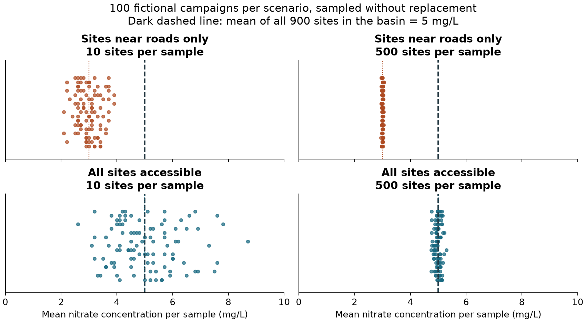
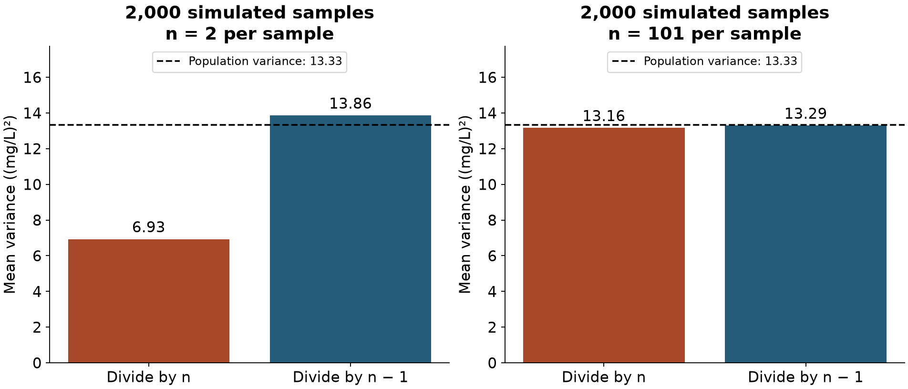

```{=html}
<div class="course-choices">
<nav class="course-language" aria-label="Course language"><a href="index.html" lang="fr" hreflang="fr">Français</a><span aria-current="page" lang="en">English</span></nav>
<nav class="course-code" aria-label="Programming language"><span aria-current="page">Python</span><a href="index-en-r.html">R</a></nav>
</div>
```

All the concepts in this session are covered in the videos. The accompanying texts summarise the main ideas and offer additional interactive animations. You can read them before or after watching, whichever works best for you. The videos are in French, with English subtitles selected by default on this page.

You will also find Python or R code examples to reuse and adapt in the practical session. You can run the code in a Jupyter notebook or RStudio, as appropriate, or simply read through it to understand the approach and adapt it to your own data.

# Session introduction

In this session, we will build the foundations of statistical analysis by working through the following questions:

- Who or what are we studying, and what data do we observe?
- What can a sample tell us about a population?
- How can probability help us describe randomness and uncertainty?
- How can we summarise data and measure how much observations differ?

You will learn to distinguish different types of variables, read a distribution, and interpret the mean, median, variance and standard deviation. We will also explore why results vary from one sample to another, and why collecting more observations does not necessarily remove bias.

# Video 1a: From populations to data

```{=typst}
#block(sticky: true)[
```

::: {.content-visible when-format="html"}
```{=html}
<div class="cours-video">
  <video id="video-s2v1-1" class="video-js vjs-big-play-centered" data-cours-video
         controls preload="metadata" playsinline
         aria-label="Video 1a: From populations to data">
    <source src="https://mediaserver.unige.ch/proxy/315613/DdRhju95m0IB8PiV.mp4?from_player=true" type="video/mp4">
    <track kind="subtitles" src="assets/video/sous-titres/S2V1_1.fr.vtt" srclang="fr" label="Français">
    <track kind="subtitles" src="assets/video/sous-titres/S2V1_1.en.vtt" srclang="en" label="English" default>
    <p>Your browser cannot display this video. Please use the Mediaserver link below.</p>
  </video>
  <div class="cours-video-erreur" role="status" hidden>
    <p>The video could not be loaded. Try again or open it on Mediaserver using the link below.</p>
    <button class="cours-video-reessayer" type="button">Try again</button>
  </div>
</div>
```

:::

[Watch the video on Mediaserver](https://mediaserver.unige.ch/play/315613).

```{=typst}
]
```

## Defining the question and the population

A statistical study always begins with a **question**. Imagine that we want to answer this one: ***“How can we describe water quality at monitoring sites within a river basin over a given period?”*** We will use this example throughout the session.

Before collecting data, we need to decide what we want to observe. The **statistical unit** is the entity on which we make our observations. Here, we choose the **water monitoring site**. For each site, we might record the nitrate concentration, whether algae are present, or how many groups of aquatic organisms we observe.

Which sites do we want to describe, and which can we actually observe? Our **target population** consists of all the monitoring sites in the basin during the period of interest. This is the group we would like to draw conclusions about. In practice, however, some sites may be difficult to access for a variety of reasons. The **accessible population** therefore consists of the sites that our study design allows us to reach. The sites we actually observe within that group form our **sample**.

## From the population to the observed sites

To explore these ideas, we will use [qualite_eau.csv](data/qualite_eau.csv). This file describes **nine fictional water monitoring sites**, which form the **sample** for our imaginary monitoring campaign. Let us look at how the observations are organised. Each row represents one site, identified by a code in the `site` column. We can check that our nine rows really do describe nine distinct sites:

```{python}
#| label: exemple-2-1-1-unites
import pandas as pd

# Adapt the file and column names for the practical session
data = pd.read_csv("data/qualite_eau.csv")
print("Rows:", len(data))
print("Distinct sites:", data["site"].nunique())
data
```

We obtain nine rows and nine distinct sites. Why check this? Three visits to the same site could produce three rows in a table while still referring to just one statistical unit. These repeated observations would not represent three independent sites. Even distinct sites are not necessarily independent, since two sites on the same watercourse may be affected by the same influences.

Another question is just as important: **does our sample represent the target population well?** If we favour sites near roads because they are easier to reach, for example, we may leave out areas with different characteristics. This selection can introduce **bias**, a systematic distortion of our results relative to what we are trying to describe. Increasing the sample size does not, by itself, solve this problem. If we keep choosing new sites in the same way, some areas remain excluded. **We then have more data, without a better representation of the target population as a whole.**

::: {.content-visible when-format="html"}
<iframe class="complement-animation" src="assets/interactifs/biais-echantillon-en.html" title="More sites, less bias? Exploring coverage of a river basin" loading="lazy" style="width:100%;height:850px;border:1px solid #ccd6dc;border-radius:6px"></iframe>
:::

::: {.content-visible unless-format="html"}
{width=95%}
:::

## Types of variables

The characteristics of our statistical units are our **variables**. The table arranges them in columns, with one observation per row and one value per cell. We can distinguish two main families.

The shared data file keeps its original French column names and category labels, so the same code works with the same file in either language. The explanations below give their English meanings.

### Categorical variables

A **categorical** variable tells us which category an observation belongs to. It describes a **qualitative characteristic**. To understand what it tells us, we need to distinguish the following cases:

- **Nominal: categories with no natural order.** In our file, `type_milieu` (type of water body) is nominal. The categories `riviere`, `ruisseau` and `canal` mean “river”, “stream” and “canal”. They distinguish types of water bodies without placing them in a natural order.

- **Ordinal: categories that can be ranked.** In contrast, `qualite_ecologique` (ecological quality) is ordinal. Its categories run from `mauvaise` (“poor”) through `moyenne` (“moderate”) and `bonne` (“good”) to `tres bonne` (“very good”). This ranking does not tell us the distance between categories. Moving from “poor” to “moderate” does not necessarily represent the same improvement as moving from “good” to “very good”.

- **Binary: only two possible categories.** The variable `algues` (algae) is binary because it has only two categories, presence and absence, stored as `True` and `False`. The word “binary” specifies the number of categories, whereas “nominal” and “ordinal” describe whether they have a natural order.

Assigning a number to a category does not turn it into a quantity. If we coded the types of water bodies as 1, 2 and 3, for instance, the mean of those codes would have no meaningful interpretation.

### Numerical variables

A **numerical** variable expresses a quantity **that we can count or measure**. This distinction helps us recognise two types of variables:

- **Discrete: a quantity that we count.** In our file, `nombre_taxons` (number of taxa) is discrete. It counts the groups of organisms identified at a site, known as taxa. This count takes whole-number values. We might observe 12 or 13 taxa at a site, but not 12.5.

- **Continuous: a quantity that we measure.** The variable `nitrates_mg_l`, on the other hand, is continuous. It measures nitrate concentration in milligrams per litre, which can theoretically take any value within an interval. Between 3 and 4 mg/L, for example, we might measure 3.2 or 3.75 mg/L, depending on the precision of the instrument.

We can see this distinction in the first few rows of the same table by selecting an identifier, a type of water body and a nitrate concentration:

```{python}
#| label: exemple-2-1-1-variables
columns = ["site", "type_milieu", "nitrates_mg_l"]
print(data[columns].head())
```

The `site` column identifies the unit, whereas `type_milieu` describes it. Nitrate concentrations are measured in **mg/L**. Taking the mean of site identifiers would therefore not have the same meaning as taking the mean of concentrations!

## Describing the data

What can we learn from these observations? **Descriptive statistics** allow us to summarise the data we have collected, for example by calculating proportions or means. In our table, **four of the nine sites have algae**, or approximately **44%** of the observed sites. This proportion describes our sample, but can we use it to claim that 44% of the sites in the target population also have algae? That takes us into **statistical inference**, which aims to draw conclusions about a population from a sample. To do this, we need to examine how the sites were selected and account for the **uncertainty** arising from having observed only part of the population. To understand that uncertainty, we now turn to **probability**.

# Video 1b: Probability and statistics {#vidéo-1.2-probabilités-et-statistiques}

```{=typst}
#block(sticky: true)[
```

::: {.content-visible when-format="html"}
```{=html}
<div class="cours-video">
  <video id="video-s2v1-2" class="video-js vjs-big-play-centered" data-cours-video
         controls preload="metadata" playsinline
         aria-label="Video 1b: Probability and statistics">
    <source src="https://mediaserver.unige.ch/proxy/315614/WVCwNZvNdGtSIMzl.mp4?from_player=true" type="video/mp4">
    <track kind="subtitles" src="assets/video/sous-titres/S2V1_2.fr.vtt" srclang="fr" label="Français">
    <track kind="subtitles" src="assets/video/sous-titres/S2V1_2.en.vtt" srclang="en" label="English" default>
    <p>Your browser cannot display this video. Please use the Mediaserver link below.</p>
  </video>
  <div class="cours-video-erreur" role="status" hidden>
    <p>The video could not be loaded. Try again or open it on Mediaserver using the link below.</p>
    <button class="cours-video-reessayer" type="button">Try again</button>
  </div>
</div>
```
:::

[Watch the video on Mediaserver](https://mediaserver.unige.ch/play/315614).

```{=typst}
]
```

## Outcomes and events

How can we reason about an observation when we do not know its outcome in advance? **Probability** allows us to describe the possible outcomes of a **random experiment** and how likely each one is. Let us return to our water monitoring campaign and consider the ecological quality recorded at a randomly selected site. In a simplified model, the observation can fall into one of four categories: “poor”, “moderate”, “good” or “very good”. The set of all possible outcomes is called the **sample space**, denoted by $\Omega$. An **event** is a set of outcomes that meet a condition we are interested in, such as recording “good” or “very good” quality.

For the rest of this exercise, we will call ecological quality “acceptable” if it is classified as “good” or “very good”. Our event therefore includes two of the four possible outcomes.

A probability is a **number between 0 and 1** that expresses how likely an event is under the model we have chosen. Suppose that the probability of acceptable quality is **0.60**, or **60%**. Keep in mind that this value is **an assumption for our simulation**, not a proportion calculated from the nine sites in the file.

## Distinguishing probability from observed frequency

With a probability of 60%, should we expect exactly 60 sites with acceptable quality every time we observe 100 sites? To explore this question, let us simulate a campaign covering 100 new sites, giving each one the same probability of acceptable quality. We also assume that the outcomes are **independent**, meaning that knowing the outcome at one site does not change the probabilities for the others. This is an assumption of our simulation, but it is not guaranteed for the nine sites in the file, which might, for example, lie on the same watercourse.

In the following code, we set the random seed with `default_rng(2026)` so that we can reproduce the same results when we run the blocks again in the same order.

```{python}
#| label: exemple-2-1-2-modele
import numpy as np

rng = np.random.default_rng(2026)
probability_acceptable = 0.60  # Model assumption
acceptable_sites = rng.random(100) < probability_acceptable
```

Once we have simulated the campaign, we can count the sites with acceptable quality and divide by the total number of sites. This gives the **observed relative frequency** of the event, the proportion of trials in which it occurred. The distinction matters: the **probability** of 60% belongs to our chosen model, whereas the **relative frequency** is calculated from the outcomes we actually obtain. The next block uses the simulation prepared just above, counting each acceptable site as 1 and each other site as 0.

```{python}
#| label: exemple-2-1-2-frequence
print("Acceptable sites:", acceptable_sites.sum(), "out of", len(acceptable_sites))
print(f"Relative frequency: {acceptable_sites.mean():.0%}")
```

We obtain **61 acceptable sites out of 100**, giving a relative frequency of **61%**. This small difference from 60% does not indicate a calculation error. It is a **random fluctuation in the simulation**. To see whether the result stays the same from one campaign to another, let us continue with the next block, which simulates 100 more sites under exactly the same assumptions.

```{python}
#| label: exemple-2-1-2-repetition
more_acceptable_sites = rng.random(100) < probability_acceptable
print(f"New campaign: {more_acceptable_sites.mean():.0%} acceptable sites")
```

The new campaign gives a relative frequency of **59%**, even though the probability in the model is still 60%. Two campaigns carried out under the same conditions can therefore produce different results. When trials are independent and have the same probability, the relative frequency tends to settle around that probability as the number of trials increases. This does not mean it will equal exactly 60% in a finite sequence, or that every new trial will bring it closer. Changing `probability_acceptable` changes the model's starting assumption, and therefore the value around which relative frequencies will tend to settle.

## Combining probabilities

How can we calculate the probability of more complex events? To choose the right operation, we first need to be clear about what we want: the probability that an event does not occur, that either of two events occurs, or that both occur. In our fictional model, let us assign a probability of 50% to “good” quality and 10% to “very good” quality, which together will give us the 60% probability of acceptable quality.

- **The complement of an event** includes every outcome in which that event does not occur. If a site has a 60% chance of acceptable quality, it has a 40% chance of quality that is not acceptable. If $A$ denotes “acceptable quality”, we can write $P(\text{not }A)=1-P(A)$, because these two possibilities cover all outcomes and cannot occur at the same time.
- **One event OR another** requires us to check whether the events can occur together. A single observation cannot be classified as both “good” and “very good”, so these events are **mutually exclusive**. We can therefore add their probabilities to obtain the probability of acceptable quality, $50\%+10\%=60\%$. In contrast, simply adding the probabilities of “acceptable” and “very good” would count very good observations twice, since they are already included in the acceptable category.
- **One event AND another** requires us to consider whether the events are independent. For two **independent** sites, knowing that the first has acceptable quality does not change the probability that the second does too. We can then multiply the probabilities to obtain $0.60\times0.60=0.36$, a **36%** chance that both sites have acceptable quality. This multiplication would not be justified without independence, for example if the same source of pollution affected both sites.

## Working back from observations to the model

We can now distinguish the two approaches named in this part of the course. **Probability** starts with a model and explores the outcomes we might observe. **Statistics** starts with observations to learn about a phenomenon and assess whether a model seems appropriate.

Returning to our file, **five of the nine sites** have good or very good quality, approximately **56%**. This differs from the 60% in our fictional model, but the difference alone is not enough to reject the model. To interpret it, we need to consider the small number of sites, how they were selected, and the fluctuations that chance could produce if the model's assumptions held.

# Video 2: Reading and summarising a distribution

```{=typst}
#block(sticky: true)[
```

::: {.content-visible when-format="html"}
```{=html}
<div class="cours-video">
  <video id="video-s2v2" class="video-js vjs-big-play-centered" data-cours-video
         controls preload="metadata" playsinline
         aria-label="Video 2: Reading and summarising a distribution">
    <source src="https://mediaserver.unige.ch/proxy/315615/8yAfr4KVkuZNeBLr.mp4?from_player=true" type="video/mp4">
    <track kind="subtitles" src="assets/video/sous-titres/S2V2.fr.vtt" srclang="fr" label="Français">
    <track kind="subtitles" src="assets/video/sous-titres/S2V2.en.vtt" srclang="en" label="English" default>
    <p>Your browser cannot display this video. Please use the Mediaserver link below.</p>
  </video>
  <div class="cours-video-erreur" role="status" hidden>
    <p>The video could not be loaded. Try again or open it on Mediaserver using the link below.</p>
    <button class="cours-video-reessayer" type="button">Try again</button>
  </div>
</div>
```
:::

[Watch the video on Mediaserver](https://mediaserver.unige.ch/play/315615).

```{=typst}
]
```

## The histogram

**How are nitrate concentrations distributed across our nine sites?** The pattern of observed values and their frequencies is the **empirical distribution**. Let us return to our water quality file. Before plotting the concentrations, we count the missing values and keep the available measurements. **A missing measurement is not a concentration of zero!**

```{python}
#| label: exemple-2-2-donnees
import pandas as pd

data = pd.read_csv("data/qualite_eau.csv")
column = "nitrates_mg_l"
print("Missing values:", data[column].isna().sum())
concentrations = data[column].dropna()
print("Observations used:", len(concentrations))
```

All **nine concentrations are available**. A **histogram** displays them by grouping values into intervals called **bins**. Here, we choose bins of equal width, 2 mg/L, so that the height of each bar shows the number of sites in that bin.

```{python}
#| label: exemple-2-2-histogramme
#| fig-width: 6
#| fig-height: 3
#| fig-alt: "Histogram of nine concentrations: three sites from 2 up to 4 mg/L, and an isolated value at 14 mg/L."
import matplotlib.pyplot as plt

fig, ax = plt.subplots(figsize=(6, 3))
ax.hist(concentrations, bins=[0, 2, 4, 6, 8, 10, 12, 14, 16],
        color="#245c79", edgecolor="white")
ax.set(xlabel="Nitrates (mg/L)", ylabel="Number of sites",
       title="Nine fictional concentrations", yticks=[0, 1, 2, 3])
plt.tight_layout()
plt.show()
```

The bin **[2, 4) mg/L**, which includes 2 but excludes 4, contains the values 2, 3 and 3 mg/L. Its bar therefore reaches **three sites**. The heights of all the bars add up to nine. These bins are used to draw the graph, and do not represent ecological quality thresholds. Changing their width or position changes the appearance of the histogram without changing the underlying data.

## The mean, median and mode

The graph reveals an isolated concentration of **14 mg/L**. The values run from 1 to 14 mg/L, giving a **range** of $14-1=13$ mg/L. Three complementary measures help us describe their centre:

- The **mean** is the sum of the concentrations divided by the number of observations, which is nine here. Every value contributes. A very high concentration pulls the mean upwards, and a very low one pulls it downwards.
- The **median** is the middle value when the observations are sorted. Here it is the fifth value, with four on either side. For an even number of observations, we take the mean of the two middle values. The median is less sensitive to extreme values than the mean because it depends on the middle position or positions in the ordered data, rather than on the sum of all the values.
- The **mode** is the most frequent value. A dataset can have several modes, or no distinct mode. For a continuous measurement, the mode also depends on measurement precision and rounding.

```{python}
#| label: exemple-2-2-centre
print(f"Mean: {concentrations.mean():.2f} mg/L")
print(f"Median: {concentrations.median():.2f} mg/L")
print("Modes (mg/L):", concentrations.mode().tolist())
```

We obtain **5 mg/L**, **4 mg/L** and **3 mg/L**, respectively. The value of 14 mg/L explains why the mean is higher than the median. It is worth checking, but being unusual is not, on its own, a reason to remove it.

## The normal distribution

The histogram helps us describe how the observed values are distributed. But how can we represent values we might encounter beyond those in our file? A **theoretical distribution** provides a model for these possible values and their associated probabilities. The **normal distribution**, for example, has a symmetric, bell-shaped curve. Its mean $\mu$ determines the centre, where the median and mode also lie. Its standard deviation $\sigma$ determines the spread. A larger standard deviation means values are more spread out around the mean and the bell is wider.

To illustrate this model with nitrate concentrations, suppose the mean is 5 mg/L and the standard deviation is 1 mg/L. We choose these parameters for the example, rather than estimating them from our nine sites. The following code draws the corresponding curve and shades the interval from 4 to 6 mg/L. This interval extends one standard deviation on either side of the mean, which we write as $\mu \pm \sigma$.

```{python}
#| label: exemple-2-2-loi-normale
#| fig-width: 7
#| fig-height: 3.5
#| fig-alt: "Theoretical normal distribution with mean 5 mg/L and standard deviation 1 mg/L. The shaded area from 4 to 6 mg/L represents a probability of approximately 68%."
import numpy as np
from scipy.stats import norm

mu, sigma = 5, 1  # Illustrative assumptions, not estimated from the nine sites
x = np.linspace(mu - 4 * sigma, mu + 4 * sigma, 500)
interval = np.linspace(4, 6, 200)
probability = norm.cdf(6, mu, sigma) - norm.cdf(4, mu, sigma)

fig, ax = plt.subplots(figsize=(8, 5))
ax.plot(x, norm.pdf(x, mu, sigma), color="#245c79", linewidth=2)
ax.fill_between(interval, norm.pdf(interval, mu, sigma),
                color="#245c79", alpha=0.25,
                label=f"Between 4 and 6 mg/L: {probability:.1%}")
ax.axvline(mu, color="#a74729", linestyle="--",
           label="Mean = median = mode: 5 mg/L")
ax.set(xlabel="Nitrates (mg/L)", ylabel="Density (per mg/L)",
       title="Illustrative normal model with standard deviation 1 mg/L", ylim=(0, 0.5))
ax.legend(loc="upper right", fontsize=8)
plt.tight_layout()
plt.show()
```

The height of the curve indicates a **density**, not a probability directly. The **area under the curve over an interval** gives the probability of a value falling in that interval. In this model, approximately **68% lies between 4 and 6 mg/L**, shown by the shaded area, and 100% lies across the full range of possible values. Increasing the standard deviation while keeping the same mean would make the bell wider and lower, while preserving its total area.

This curve does not establish that concentrations in the basin follow a normal distribution. Our nine values, including the one at 14 mg/L, **are not enough on their own to justify choosing a normal model**. The model also has a limitation for concentrations: it assigns some probability to negative values, whereas a concentration cannot be below zero. We therefore need to consider whether that probability is small enough for the approximation to be acceptable, while also checking whether the model's shape suits the observations. In the next video, we will look more closely at how to measure and interpret their variability.

# Video 3: Measuring variability and understanding the stability of a mean

```{=typst}
#block(sticky: true)[
```

::: {.content-visible when-format="html"}
```{=html}
<div class="cours-video">
  <video id="video-s2v3" class="video-js vjs-big-play-centered" data-cours-video
         controls preload="metadata" playsinline
         aria-label="Video 3: Measuring variability and understanding the stability of a mean">
    <source src="https://mediaserver.unige.ch/proxy/315616/teQf3KGSfqdynxC3.mp4?from_player=true" type="video/mp4">
    <track kind="subtitles" src="assets/video/sous-titres/S2V3.fr.vtt" srclang="fr" label="Français">
    <track kind="subtitles" src="assets/video/sous-titres/S2V3.en.vtt" srclang="en" label="English" default>
    <p>Your browser cannot display this video. Please use the Mediaserver link below.</p>
  </video>
  <div class="cours-video-erreur" role="status" hidden>
    <p>The video could not be loaded. Try again or open it on Mediaserver using the link below.</p>
    <button class="cours-video-reessayer" type="button">Try again</button>
  </div>
</div>
```
:::

[Watch the video on Mediaserver](https://mediaserver.unige.ch/play/315616).

```{=typst}
]
```

## Variance

In the previous section, we found a **mean concentration of 5 mg/L**, while the nine values in the file are **1, 2, 3, 3, 4, 5, 6, 7 and 14 mg/L**. Is that mean enough to understand the differences between sites? If all nine concentrations were 5 mg/L, we would obtain exactly the same mean, but the situation would be very different. Measures of **dispersion**, or spread, help us make this distinction by describing how widely observations are scattered around their centre.

To build such a measure, let us start by comparing each concentration with the mean. Site S01, at 1 mg/L, has a deviation of $1-5=-4$ mg/L, whereas site S09, at 14 mg/L, has a deviation of $14-5=+9$ mg/L. Deviations tell us both how far a value is from the mean and which side of it the value lies on. Yet deviations from the mean of the data always sum to zero, because the positive and negative deviations cancel out. To measure spread without this cancellation, we square each deviation and then take their mean. This defines the **descriptive variance**:

$$
V=\frac{1}{n}\sum_{i=1}^{n}(x_i-\bar{x})^2.
$$

Here, $x_i$ is the concentration at site $i$, $\bar{x}$ is the mean concentration, and $n$ is the number of observations used. For our file, we calculate $(1-5)^2+(2-5)^2+\cdots+(14-5)^2$, giving a sum of **120 (mg/L)²**. Dividing by nine gives a variance of **13.33 (mg/L)²**. If all concentrations were identical, every deviation would be zero and the variance would also be zero, as we would expect when there is no spread.

Let us apply this calculation directly to the `nitrates_mg_l` column. The next block reloads the file so that you can run this section without rerunning the blocks from the previous video, then keeps the available concentrations. In our dataset, all nine sites have a measurement and contribute to the calculation. The argument `ddof=0` corresponds to division by $n$ in the descriptive formula.

```{python}
#| label: exemple-2-3-descriptive
import pandas as pd

data = pd.read_csv("data/qualite_eau.csv")
concentrations = data["nitrates_mg_l"].dropna()
descriptive_variance = concentrations.var(ddof=0)
print(f"Descriptive variance: {descriptive_variance:.2f} (mg/L)²")
```

## Standard deviation

The calculation confirms a variance of **13.33 (mg/L)²**, but how should we interpret this when concentrations are measured in mg/L? Squaring the deviations has also squared the units, making comparisons with the measurements less intuitive. We therefore take the square root of the variance to return to the original unit and obtain the **standard deviation**. The following block uses the variance just calculated from the nine concentrations.

```{python}
#| label: exemple-2-3-ecart-type
import numpy as np

descriptive_std = np.sqrt(descriptive_variance)
print(f"Descriptive standard deviation: {descriptive_std:.2f} mg/L")
```

We obtain a **standard deviation of 3.65 mg/L**, which we can consider alongside our mean of 5 mg/L. This gives us a scale for the spread between sites. It does not mean that every concentration is exactly 3.65 mg/L from the mean, as we saw with S01 and S09, whose deviations are −4 and +9 mg/L, respectively.

**Be careful:** it is not a measure of uncertainty about the mean either. Dispersion describes differences between observed concentrations, whereas uncertainty concerns what we can estimate about the population from this sample.

Site S09 also helps us understand a limitation of these measures. Its deviation of +9 mg/L contributes $9^2=81$ out of the total sum of squares of 120 (mg/L)², more than two thirds of the total. Variance and standard deviation therefore give substantial weight to concentrations far from the mean. This does not justify removing S09, but it does invite us to check whether its high concentration reflects a real situation or a measurement error. To describe a strongly skewed distribution, we can complement these measures with the median and, later in the course, the interquartile range.

## Describing the sites or estimating the basin's variance?

So far, we have described the spread of the **nine observed concentrations** by dividing the sum of squared deviations by nine. If we want these sites to tell us about variability across all sites in the basin, however, our goal changes. We are now trying to **estimate a population variance** from a sample. This is where division by **$n-1$**, rather than $n$, comes in.

**Why make this correction?** We measure deviations from a mean calculated using the sample's own observations. That mean is particularly well placed among those data, which tends to make their spread look a little smaller than it is in the population. For **independent observations from the same distribution with finite variance**, dividing by $n-1$ rather than $n$ increases the calculated variance slightly and **compensates for this bias**. If we repeated the study across many samples under these assumptions, the estimated variances would average out to the population variance. **This does not guarantee an accurate result for every sample, and it does not correct an unrepresentative choice of sites.**

Let us return to our concentrations to see what changes in practice. The sum of squared deviations is still **120 (mg/L)²**, but we now divide by $9-1=8$, giving **15 (mg/L)²**. The next block performs this calculation with `ddof=1`, using the same data as before. This illustrates the correction without claiming that the nine sites in the file form an independent random sample of all sites in the basin.

```{=typst}
#block(breakable: false)[
```

```{python}
#| label: exemple-2-3-estimation
print(f"Estimated variance: {concentrations.var(ddof=1):.2f} (mg/L)²")
print(f"Estimated standard deviation: {concentrations.std(ddof=1):.2f} mg/L")
```

```{=typst}
]
```

The result is an estimated variance of **15.00 (mg/L)²** and an estimated standard deviation of **3.87 mg/L**, compared with 13.33 (mg/L)² and 3.65 mg/L for the descriptive measures. The concentrations have not changed, only the denominator has. When comparing results, check which convention is used. By default, `pandas` uses `ddof=1` for variance and standard deviation, whereas `numpy.var` uses `ddof=0`. Under the assumptions above, the correction makes the variance estimator unbiased. Taking the square root does not preserve this property exactly, so the corresponding standard deviation estimator is not itself unbiased.

::: {.content-visible when-format="html"}
<iframe class="complement-animation" src="assets/interactifs/complements-en.html?animation=variance" title="Video 2.3 interactive example: variance" loading="lazy" style="width:100%;height:720px;border:1px solid #ccd6dc;border-radius:6px"></iframe>
:::

::: {.content-visible unless-format="html"}
{width=95%}
:::

## The coefficient of variation

Does a standard deviation of **3.65 mg/L** indicate substantial variability relative to the mean concentration? The **coefficient of variation** helps us answer this by dividing the standard deviation by the mean to express relative variability. Using the two descriptive measures for our nine sites, we obtain $3.65/5\approx0.73$, or approximately **73%**. This means that the standard deviation is about 73% of the mean. It does not mean that 73% of the sites are polluted or exceed a water quality threshold.

The ratio has no unit, because both the standard deviation and the mean are expressed in mg/L. It can therefore help us compare relative variability across datasets with different mean levels, provided that the comparison makes sense in context. To use it, **the mean must be positive and sufficiently far from zero, on a scale where zero means the absence of the quantity being measured**. Concentration meets this last condition, but a basin with a mean concentration close to zero would produce an unstable ratio. The coefficient of variation also remains sensitive to extreme values, such as the concentration at S09, because it depends on both the mean and the standard deviation.

## The law of large numbers

The variability between sites brings us to one final question: **how does the mean respond when we add an observation?** Imagine a campaign in which five concentrations have a mean of 5 mg/L. If a sixth measurement is 14 mg/L, like S09, the mean becomes $(5\times5+14)/6=6.5$ mg/L. With 100 measurements sharing the same initial mean of 5 mg/L, adding a measurement of 14 mg/L would raise the mean only to $(100\times5+14)/101\approx5.09$ mg/L. A new concentration therefore has less influence when the sample is already large.

The **law of large numbers** describes the related idea of convergence. For independent observations from the same distribution with a finite mean, the sample mean tends towards the population mean as the sample size grows. As in the variance animation, we can treat the nine concentrations in the file as a small fictional population and draw independent samples **with replacement**. Each concentration remains available after a draw and can therefore be selected again. As the draws accumulate, their mean tends towards **5 mg/L**, though it need not move closer with every new observation.

Finally, let us return to coverage of the basin, which we explored in the first animation. If we select only sites near roads, collecting more observations may stabilise the mean around a value that does not represent the whole basin. Similarly, taking more measurements with a poorly calibrated sensor does not remove its systematic error. The **law of large numbers is therefore no substitute for a study design suited to the target population**, and it does not turn the distribution of concentrations into a normal distribution.

# Questions about this session {#questions-session-02}

Is a concept still unclear, does a result surprise you, or would you like to explore an example further? Post your question in the SpeakUp space below. Take a moment to read other students’ questions and vote for those you would like answered. Sorting by votes brings the questions of greatest interest to the group to the top.

This space is shared by the French and English versions of the course and by students using Python or R. If your question is about code, mention the language you are using and the example you are working on.

::: {.content-visible when-format="html"}
<iframe class="speakup-room" src="https://web.speakup.info/room/join/93131?theme=UniGE&amp;lang=en" title="SpeakUp: questions and votes for session 2, room 93131" loading="lazy" style="display:block;width:100%;height:clamp(480px,80vh,760px);border:1px solid #ccd6dc;border-radius:6px"></iframe>

If the room does not appear within this page, use the link below.
:::

[Open the SpeakUp room for session 2](https://web.speakup.info/room/join/93131?theme=UniGE&lang=en){target="_blank" rel="noopener"}. **Room code: 93131.**
