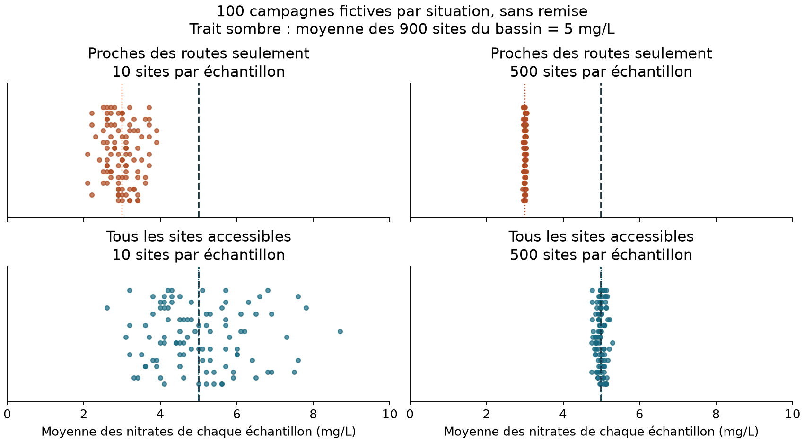
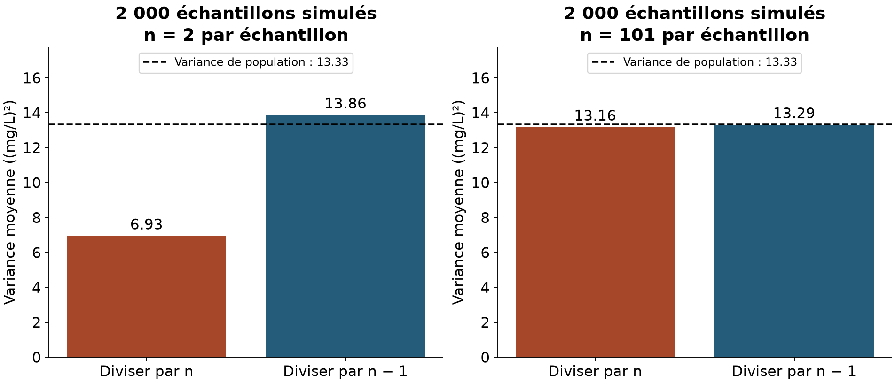

---
title: "**Session 2** : Concepts de base de probabilité et de statistique"
# subtitle: "Analyse de données statistiques"
jupyter: python3
format:
  html:
    theme: cosmo
    css:
      - ../../styles.css
      - assets/video/vendor/videojs-8.23.8/video-js.min.css
      - assets/video/lecteur.css
    toc: true
    toc-depth: 3
    toc-title: "Sur cette page"
    smooth-scroll: true
    code-fold: false
    code-summary: "Afficher le code Python"
    code-tools: true
    fig-responsive: true
    include-in-header:
      - text: |
          <style>
          main.content p, main.content li, main.content figcaption {
            text-align: justify;
            hyphens: auto;
          }
          main.content pre, main.content .cours-video p {
            text-align: left;
          }
          </style>
    include-after-body:
      - text: |
          <script src="../session-02/assets/interactifs/cadrage-complements.js"></script>
          <script src="../session-02/assets/video/vendor/videojs-8.23.8/video.min.js"></script>
          <script src="../session-02/assets/video/vendor/videojs-8.23.8/fr.js"></script>
          <script src="../session-02/assets/video/lecteur.js"></script>
  typst:
    toc: true
    papersize: a4
    margin:
      x: 2.2cm
      y: 2.2cm
    fig-format: png
    include-in-header:
      - text: |
          #set par(justify: true)
          #show raw.where(block: true): it => block(breakable: false, it)
          #let original-skylighting = Skylighting
          #let Skylighting(..args) = block(breakable: false, original-skylighting(..args))
execute:
  echo: true
  warning: false
  error: false
---

Toutes les notions de la session sont entièrement présentées dans les vidéos. Les textes qui les accompagnent sont là pour en résumer le contenu et proposer des animations complémentaires. Vous pouvez les lire avant ou après la vidéo, selon vos préférences.

Vous y trouverez également des exemples de code en Python ou R à reprendre et à adapter lors du TP. Les blocs de code sont exécutables dans un carnet Jupyter ou dans R-Studio, mais vous pouvez aussi les lire pour comprendre la logique et les adapter à vos propres données.

# Introduction de la session

Dans cette session, on pose les bases de l'analyse statistique. Nous allons répondre aux questions suivantes :

- Qui étudie-t-on et quelles données observe-t-on ?
- Que peut-on apprendre sur une population à partir d'un échantillon ? 
- Comment les probabilités permettent-elles de décrire le hasard et les incertitudes ? 
- Comment résumer des données et quantifier leur diversité ? 

Vous apprendrez à distinguer les types de variables, à lire une distribution et à interpréter la moyenne, la médiane, la variance et l'écart-type. Nous verrons aussi pourquoi les résultats fluctuent d'un échantillon à l'autre et pourquoi davantage d'observations ne suffit pas à corriger certains biais.


# Vidéo 1a : Des populations aux données

```{=typst}
#block(sticky: true)[
```

::: {.content-visible when-format="html"}
```{=html}
<div class="cours-video">
  <video id="video-s2v1-1" class="video-js vjs-big-play-centered" data-cours-video
         controls preload="metadata" playsinline
         aria-label="Vidéo 1a : Des populations aux données">
    <source src="https://mediaserver.unige.ch/proxy/315613/DdRhju95m0IB8PiV.mp4?from_player=true" type="video/mp4">
    <track kind="subtitles" src="assets/video/sous-titres/S2V1_1.fr.vtt" srclang="fr" label="Français" default>
    <track kind="subtitles" src="assets/video/sous-titres/S2V1_1.en.vtt" srclang="en" label="English">
    <p>Votre navigateur ne peut pas afficher cette vidéo. Utilisez le lien Mediaserver ci-dessous.</p>
  </video>
  <div class="cours-video-erreur" role="status" hidden>
    <p>La vidéo n'a pas pu être chargée. Vous pouvez réessayer ou l'ouvrir sur Mediaserver avec le lien ci-dessous.</p>
    <button class="cours-video-reessayer" type="button">Réessayer</button>
  </div>
</div>
```

:::

[Regarder la vidéo sur Mediaserver](https://mediaserver.unige.ch/play/315613).

```{=typst}
]
```

## Définir la question et la population étudiée

Une étude statistique commence toujours par une **question**. Imaginons que nous souhaitions répondre à celle-ci : ***« Comment caractériser la qualité de l'eau sur les sites de suivi d'un bassin, pendant une période donnée ? »***  On utilisera cet exemple tout au long de la session.

Avant de recueillir des données, nous devons préciser ce que nous voulons observer. L'**unité statistique** est l'entité sur laquelle portent nos observations. Ici, nous choisissons le **site de suivi de l'eau** : pour chaque site, nous pouvons relever la concentration en nitrates, la présence d'algues ou encore le nombre de groupes d'organismes aquatiques observés.

Quels sites souhaitons-nous décrire, et lesquels pouvons-nous réellement observer ? Notre **population cible** est l'ensemble des sites de suivi du bassin pendant la période retenue : c'est sur cet ensemble que nous aimerions tirer des conclusions. Cependant, certains sites peuvent être difficiles d'accès pour tout un tas de raisons. La **population accessible** regroupe donc les sites que notre dispositif d'étude permet effectivement d'atteindre. Et parmi eux, ceux que nous observons finalement constituent notre **échantillon**.

## Passer de la population aux sites observés

Pour explorer toutes ces notions, nous utiliserons le fichier [qualite_eau.csv](data/qualite_eau.csv). Il décrit **neuf sites fictifs de suivi de l'eau**, qui forment l'**échantillon** de notre campagne imaginaire. Regardons comment ces observations sont organisées : dans ce fichier, chaque ligne correspond à un site, identifié par un code dans la colonne site. Vérifions que nos neuf lignes décrivent bien neuf sites distincts :

```{python}
#| label: exemple-2-1-1-unites
import pandas as pd

# Adapter le fichier et la colonne au TP
donnees = pd.read_csv("data/qualite_eau.csv")
print("Lignes :", len(donnees))
print("Sites distincts :", donnees["site"].nunique())
donnees
```

Nous obtenons neuf lignes et neuf sites distincts. Pourquoi faire cette vérification ? Parce que trois visites du même site pourraient produire trois lignes dans un tableau, tout en ne concernant qu'une seule unité statistique. Ces observations répétées ne constituent pas trois sites indépendants, et même des sites distincts ne sont pas nécessairement indépendants : deux sites situés sur le même cours d'eau peuvent être soumis aux mêmes influences.

Une autre question reste essentielle : **notre échantillon représente-t-il bien la population cible ?** Par exemple, si nous privilégions les sites proches des routes (car plus faciles d'accès), nous risquons de laisser de côté des secteurs présentant d'autres caractéristiques. Cette sélection peut introduire un **biais**, c'est-à-dire déformer systématiquement les résultats par rapport à ce que nous cherchons à décrire. Et augmenter la taille de l'échantillon ne suffit pas à corriger ce problème ! En effet si les nouveaux sites sont choisis selon les mêmes critères, certains secteurs restent à l'écart : **nous avons alors davantage de données, sans qu'elles représentent mieux l'ensemble de la population cible.**

::: {.content-visible when-format="html"}
<iframe class="complement-animation" src="assets/interactifs/biais-echantillon.html" title="Plus de sites, moins de biais ? Simulation de la couverture d'un bassin" loading="lazy" style="width:100%;height:850px;border:1px solid #ccd6dc;border-radius:6px"></iframe>
:::

::: {.content-visible unless-format="html"}
{width=95%}
:::

## Les types de variables

Les caractéristiques des unités sont nos **variables**. Le tableau les organise en colonnes, avec une observation par ligne et une valeur par cellule. Distinguons deux familles :

### Les variables catégorielles

Une variable **catégorielle** décrit à quelle catégorie appartient chaque observation, c'est un **indicateur qualitatif**. Pour comprendre ce qu'elle nous indique, distinguons les cas suivants :

- **Nominale : des catégories sans ordre naturel.** Dans notre fichier, `type_milieu` est une variable nominale : les catégories « rivière », « ruisseau » et « canal » permettent de distinguer des types de milieux, sans qu'il existe un ordre naturel entre eux.

- **Ordinale : des catégories que l'on peut ordonner.** À l'inverse, `qualite_ecologique` est une variable ordinale, car ses catégories peuvent être classées de « mauvaise » à « très bonne ». Cet ordre ne nous indique toutefois pas la distance entre deux catégories : le passage de « mauvaise » à « moyenne » ne représente pas nécessairement la même amélioration que celui de « bonne » à « très bonne ».

- **Binaire : seulement deux catégories possibles.** Enfin, `algues` est une variable binaire, puisqu'elle ne comporte que deux catégories : présence ou absence d'algues. Le terme « binaire » précise le nombre de catégories, tandis que « nominale » et « ordinale » indiquent si elles possèdent un ordre naturel.

Attribuer un numéro à une catégorie ne la transforme pas en quantité : coder les milieux par 1, 2 et 3 ne donnerait, par exemple, aucun sens à la moyenne de ces codes.

### Les variables numériques

Une variable **numérique** exprime une quantité **que l'on peut compter ou mesurer**. Cette distinction nous permet de reconnaître deux types de variables :

- **Discrète : une quantité que l'on compte.** Dans notre fichier, `nombre_taxons` est une variable discrète : elle correspond au nombre de groupes d'organismes identifiés, appelés taxons. Ce comptage prend des valeurs entières : nous pouvons observer 12 ou 13 taxons sur un site, mais pas 12,5.

- **Continue : une quantité que l'on mesure.** La variable `nitrates_mg_l`, en revanche, est continue : elle mesure une concentration en nitrates, exprimée en milligrammes par litre, qui peut théoriquement prendre toute valeur dans un intervalle. Entre 3 et 4 mg/L, nous pourrions ainsi mesurer 3,2 ou 3,75 mg/L, selon la précision de l'instrument.

Retrouvons cette distinction dans les premières lignes du même tableau : un identifiant, un milieu et une concentration en nitrates.

```{python}
#| label: exemple-2-1-1-variables
colonnes = ["site", "type_milieu", "nitrates_mg_l"]
print(donnees[colonnes].head())
```

Le `site` identifie l'unité, tandis que `type_milieu` la décrit. Les nitrates eux sont mesurés en **mg/L**. Calculer une moyenne des identifiants n'aurait donc pas le même sens que calculer celle des concentrations !

## Décrire les données

Que pouvons-nous maintenant apprendre à partir de ces observations ? La statistique **descriptive** nous permet de résumer les données recueillies, par exemple en calculant des proportions ou des moyennes. Dans notre tableau, **quatre sites sur neuf présentent des algues**, soit environ **44 %** des sites observés. Cette proportion décrit notre échantillon, mais pouvons-nous l'utiliser pour affirmer que 44 % des sites de la population cible présentent eux aussi des algues ? Nous passons alors à l'**inférence statistique**, qui cherche à tirer des conclusions sur une population à partir d'un échantillon. Pour le faire, il faudra examiner la manière dont les sites ont été sélectionnés et tenir compte de **l'incertitude** liée au fait que nous n'avons observé qu'une partie de la population. C'est pour comprendre cette incertitude que nous allons nous intéresser aux **probabilités**.

# Vidéo 1b : Probabilités et statistiques {#vidéo-1.2-probabilités-et-statistiques}

```{=typst}
#block(sticky: true)[
```

::: {.content-visible when-format="html"}
```{=html}
<div class="cours-video">
  <video id="video-s2v1-2" class="video-js vjs-big-play-centered" data-cours-video
         controls preload="metadata" playsinline
         aria-label="Vidéo 1b : Probabilités et statistiques">
    <source src="https://mediaserver.unige.ch/proxy/315614/WVCwNZvNdGtSIMzl.mp4?from_player=true" type="video/mp4">
    <track kind="subtitles" src="assets/video/sous-titres/S2V1_2.fr.vtt" srclang="fr" label="Français" default>
    <track kind="subtitles" src="assets/video/sous-titres/S2V1_2.en.vtt" srclang="en" label="English">
    <p>Votre navigateur ne peut pas afficher cette vidéo. Utilisez le lien Mediaserver ci-dessous.</p>
  </video>
  <div class="cours-video-erreur" role="status" hidden>
    <p>La vidéo n'a pas pu être chargée. Vous pouvez réessayer ou l'ouvrir sur Mediaserver avec le lien ci-dessous.</p>
    <button class="cours-video-reessayer" type="button">Réessayer</button>
  </div>
</div>
```
:::

[Regarder la vidéo sur Mediaserver](https://mediaserver.unige.ch/play/315614).

```{=typst}
]
```

## Résultats et événements

Comment raisonner lorsque nous ne connaissons pas à l'avance le résultat d'une observation ? Les **probabilités** nous permettent de décrire les résultats possibles d'une **expérience aléatoire** et les chances associées à chacun d'eux. Reprenons notre campagne de suivi de l'eau et intéressons-nous à la qualité écologique qui sera relevée sur un site sélectionné au hasard. Dans un modèle simplifié, ce relevé peut appartenir à l'une des quatre catégories suivantes : « mauvaise », « moyenne », « bonne » ou « très bonne ». L'ensemble de ces résultats possibles constitue l'**univers**, que l'on note $\Omega$. Un **événement** correspond à un ensemble de résultats qui satisfont une condition qui nous intéresse, par exemple obtenir une qualité « bonne » ou « très bonne ».

Pour la suite de cet exercice, nous appellerons « acceptable » une qualité écologique classée « bonne » ou « très bonne ». Notre événement regroupe donc deux des quatre résultats possibles. 

Une probabilité est un **nombre compris entre 0 et 1** qui traduit les chances qu'un événement se réalise dans le modèle retenu. Supposons ici que la probabilité d'obtenir une qualité acceptable soit de **0,60**, soit **60 %**. Gardons bien en tête que cette valeur est **une hypothèse de simulation !** Non pas une proportion calculée à partir des neuf sites du fichier.

## Distinguer une probabilité d'une fréquence observée

Avec une probabilité de 60 %, devons-nous nous attendre à obtenir exactement 60 sites de qualité acceptable chaque fois que nous en observons 100 ? Pour explorer cette question, simulons une campagne portant sur 100 nouveaux sites, en attribuant à chacun la même probabilité de qualité acceptable. Nous supposons également que les résultats sont **indépendants**, ce qui signifie que connaître le résultat d'un site ne change pas les probabilités concernant les autres. Cette hypothèse fait partie de notre simulation, mais elle n'est pas garantie pour les neuf sites du fichier, qui pourraient (par exemple) être reliés par un même cours d'eau.

Dans le code suivant, la graine aléatoire (ou *seed* en anglais) `default_rng(2026)`est fixée afin de pouvoir reproduire les mêmes résultats lorsque nous réexécutons les blocs dans le même ordre.

```{python}
#| label: exemple-2-1-2-modele
import numpy as np

generateur = np.random.default_rng(2026)
probabilite_acceptable = 0.60  # Hypothèse du modèle
sites_acceptables = generateur.random(100) < probabilite_acceptable
```

Une fois la campagne simulée, nous pouvons compter le nombre de sites de qualité acceptable et le diviser par le nombre total de sites. Nous obtenons ainsi la **fréquence observée** de notre événement, c'est-à-dire la proportion d'essais au cours desquels il s'est réalisé. La distinction est importante : la **probabilité** de 60 % appartient au modèle que nous avons choisi, tandis que la **fréquence** se calcule à partir des résultats effectivement obtenus. Le bloc de code suivant reprend la simulation préparée juste au-dessus, en comptant chaque site acceptable pour 1 et chaque autre site pour 0.

```{python}
#| label: exemple-2-1-2-frequence
print("Sites acceptables :", sites_acceptables.sum(), "sur", len(sites_acceptables))
print(f"Fréquence : {sites_acceptables.mean():.0%}")
```

Nous obtenons **61 sites acceptables sur 100**, soit une fréquence de **61 %**. Ce résultat légèrement différent de 60 % ne signale pas une erreur dans le calcul, mais une **fluctuation liée au hasard de la simulation**. Pour voir si le résultat reste identique d'une campagne à l'autre, continuons avec le bloc suivant qui simule 100 autres sites en conservant exactement les mêmes hypothèses.

```{python}
#| label: exemple-2-1-2-repetition
autres_sites_acceptables = generateur.random(100) < probabilite_acceptable
print(f"Nouvelle campagne : {autres_sites_acceptables.mean():.0%} de sites acceptables")
```

Cette nouvelle campagne donne une fréquence de **59 %**, alors que la probabilité fixée dans le modèle est toujours de 60 %. Nous voyons donc que deux campagnes réalisées dans les mêmes conditions peuvent produire des résultats différents. Lorsque les essais sont indépendants et réalisés avec la même probabilité, la fréquence tend à se stabiliser autour de cette probabilité à mesure que le nombre d'essais augmente. Cela ne signifie pas qu'elle sera exactement égale à 60 % dans une série finie, ni qu'elle s'en rapprochera à chaque nouvel essai. Si vous modifiez `probabilite_acceptable`, vous changez l'hypothèse de départ du modèle, et donc la valeur autour de laquelle les fréquences auront tendance à se stabiliser.

## Combiner des probabilités

Nous pouvons maintenant nous demander comment calculer la probabilité d'événements plus complexes. Pour choisir la bonne opération, il faut d'abord préciser ce que nous cherchons : la probabilité du contraire d'un événement, celle d'obtenir l'un ou l'autre de deux résultats, ou celle d'obtenir deux résultats ensemble. Dans notre modèle fictif, attribuons une probabilité de 50 % à la catégorie « bonne » et de 10 % à la catégorie « très bonne », ce qui nous permettra de retrouver les 60 % de qualité acceptable.

- **L'événement contraire** regroupe tous les résultats pour lesquels l'événement qui nous intéresse ne se réalise pas. Si un site a 60 % de chances d'avoir une qualité acceptable, il a donc 40 % de chances de ne pas avoir une qualité acceptable. En notant $A$ l'événement « qualité acceptable », nous pouvons écrire $P(\text{non }A)=1-P(A)$, puisque ces deux possibilités couvrent tous les résultats et ne peuvent pas se produire en même temps.
- **L'un OU l'autre de deux événements** nous amène à vérifier s'ils peuvent se produire simultanément. Un même relevé ne peut pas être classé à la fois « bonne » et « très bonne », ce qui rend ces événements **incompatibles**. Nous pouvons donc additionner leurs probabilités pour obtenir celle d'une qualité acceptable, soit $50\%+10\%=60\%$. En revanche, additionner directement les probabilités de « acceptable » et de « très bonne » compterait deux fois les relevés de très bonne qualité, puisqu'ils appartiennent déjà à la catégorie acceptable.
- **L'un ET l'autre de deux événements** nous conduit à nous interroger sur leur dépendance. Pour deux sites **indépendants**, savoir que le premier a une qualité acceptable ne change pas la probabilité que le second ait lui aussi une qualité acceptable. Nous pouvons alors multiplier leurs probabilités et obtenir $0{,}60\times0{,}60=0{,}36$, soit **36 %** de chances que les deux sites aient une qualité acceptable. Cette multiplication ne serait toutefois pas justifiée sans l'hypothèse d'indépendance, par exemple si une même source de pollution influençait les deux sites.

## Revenir des observations au modèle

Nous pouvons ainsi mieux distinguer les deux démarches qui donnent son titre à cette partie : les **probabilités** partent d'un modèle pour explorer les résultats que l'on pourrait observer, tandis que les **statistiques** partent des observations pour apprendre sur le phénomène et examiner si un modèle paraît adapté. 

Revenons à notre fichier, dans lequel **cinq sites sur neuf** ont une qualité bonne ou très bonne, soit environ **56 %**. Cette proportion est différente des 60 % de notre modèle fictif, mais cet écart ne suffit pas, à lui seul, à remettre le modèle en cause. Pour l'interpréter, nous devons tenir compte du faible nombre de sites, de leur mode de sélection et des fluctuations que le hasard pourrait produire si les hypothèses du modèle étaient respectées.

# Vidéo 2 : Lire et résumer une distribution

```{=typst}
#block(sticky: true)[
```

::: {.content-visible when-format="html"}
```{=html}
<div class="cours-video">
  <video id="video-s2v2" class="video-js vjs-big-play-centered" data-cours-video
         controls preload="metadata" playsinline
         aria-label="Vidéo 2 : Lire et résumer une distribution">
    <source src="https://mediaserver.unige.ch/proxy/315615/8yAfr4KVkuZNeBLr.mp4?from_player=true" type="video/mp4">
    <track kind="subtitles" src="assets/video/sous-titres/S2V2.fr.vtt" srclang="fr" label="Français" default>
    <track kind="subtitles" src="assets/video/sous-titres/S2V2.en.vtt" srclang="en" label="English">
    <p>Votre navigateur ne peut pas afficher cette vidéo. Utilisez le lien Mediaserver ci-dessous.</p>
  </video>
  <div class="cours-video-erreur" role="status" hidden>
    <p>La vidéo n'a pas pu être chargée. Vous pouvez réessayer ou l'ouvrir sur Mediaserver avec le lien ci-dessous.</p>
    <button class="cours-video-reessayer" type="button">Réessayer</button>
  </div>
</div>
```
:::

[Regarder la vidéo sur Mediaserver](https://mediaserver.unige.ch/play/315615).

```{=typst}
]
```

## L'histogramme

**Comment les concentrations en nitrates se répartissent-elles entre nos neuf sites ?** Cette répartition des valeurs et de leurs fréquences est la **distribution empirique**. Reprenons notre fichier de qualité de l'eau : avant de la représenter, comptons les valeurs manquantes et conservons les concentrations disponibles. **Attention : Une mesure absente n'est pas une concentration nulle !**

```{python}
#| label: exemple-2-2-donnees
import pandas as pd

donnees = pd.read_csv("data/qualite_eau.csv")
colonne = "nitrates_mg_l"
print("Valeurs absentes :", donnees[colonne].isna().sum())
concentrations = donnees[colonne].dropna()
print("Observations utilisées :", len(concentrations))
```

Les **neuf concentrations sont disponibles**. Pour les représenter, un **histogramme** regroupe les valeurs dans des intervalles appelés **classes**. Ici, nous choisissons des classes de même largeur, 2 mg/L, et la hauteur de chaque barre indique le nombre de sites dans cette classe.

```{python}
#| label: exemple-2-2-histogramme
#| fig-width: 6
#| fig-height: 3
#| fig-alt: "Histogramme de neuf concentrations : trois sites entre 2 et 4 mg/L, et une valeur isolée à 14 mg/L."
import matplotlib.pyplot as plt

fig, ax = plt.subplots(figsize=(6, 3))
ax.hist(concentrations, bins=[0, 2, 4, 6, 8, 10, 12, 14, 16],
        color="#245c79", edgecolor="white")
ax.set(xlabel="Nitrates (mg/L)", ylabel="Effectif",
       title="Neuf concentrations fictives", yticks=[0, 1, 2, 3])
plt.tight_layout()
plt.show()
```

La classe **[2 ; 4[ mg/L** contient 2, 3 et 3 mg/L : sa barre atteint donc **trois sites**. La somme des hauteurs de toute les barres vaut neuf. Ces classes servent au graphique, mais ce ne sont pas des seuils de qualité écologique. Leur largeur des classes et leur position modifient l'apparence de l'histogramme, sans changer les données elle-mêmes.

## La moyenne, la médiane et le mode

Le graphique révèle une concentration isolée à **14 mg/L**. Les valeurs vont de 1 à 14 mg/L : leur **étendue** vaut donc $14-1=13$ mg/L. Pour décrire leur centre, trois indicateurs se complètent :

- La **moyenne** est la somme des concentrations divisée par le nombre d'observations, ici neuf. Chaque valeur intervient : une concentration très élevée tire la moyenne vers le haut, et une très basse la tire vers le bas.
- La **médiane** est la valeur centrale de la série ordonnée, ici la cinquième (quatre de chaque côté). Pour un effectif pair, on fait la moyenne des deux valeurs centrales. Elle est moins sensible aux valeurs extrêmes que la moyenne puisque les valeurs des données ne rentrent pas en compte dans le calcul, mais seulement leur position dans la série ordonnée.
- Le **mode** est la valeur la plus fréquente. Il peut y avoir plusieurs modes pour une même série de données, vois aucun. Pour une mesure continue, il dépend aussi de la précision et des arrondis.

```{python}
#| label: exemple-2-2-centre
print(f"Moyenne : {concentrations.mean():.2f} mg/L")
print(f"Médiane : {concentrations.median():.2f} mg/L")
print("Modes (mg/L) :", concentrations.mode().tolist())
```

Nous obtenons **5 mg/L**, **4 mg/L** et **3 mg/L** respectivement. La valeur de 14 mg/L explique pourquoi la moyenne dépasse la médiane. Elle mérite une vérification, mais son caractère inhabituel ne suffit pas à justifier sa suppression.

## La loi normale

L'histogramme nous aide à décrire la répartition des valeurs observées. Mais comment représenter les valeurs que nous pourrions rencontrer, au-delà de celles de notre fichier ? Une **distribution théorique** permet de proposer un modèle pour ces valeurs et les probabilités qui leur sont associées. La **loi normale**, par exemple, se représente par une courbe en forme de cloche symétrique. Sa moyenne $\mu$ détermine le centre de la courbe, où se trouvent également la médiane et le mode. Son écart-type $\sigma$ détermine son étalement : plus il est grand, plus les valeurs sont dispersées autour de la moyenne et plus la cloche est large.

Pour illustrer ce modèle avec les concentrations en nitrates, supposons une moyenne de 5 mg/L et un écart-type de 1 mg/L. Nous choisissons ici ces deux paramètres pour l'exemple, sans les estimer à partir de nos neuf sites. Le code suivant trace la courbe correspondante et colore l'intervalle allant de 4 à 6 mg/L. Cet intervalle s'étend donc d'un écart-type de part et d'autre de la moyenne, ce que nous notons $\mu \pm \sigma$.

```{python}
#| label: exemple-2-2-loi-normale
#| fig-width: 7
#| fig-height: 3.5
#| fig-alt: "Loi normale théorique centrée sur 5 mg/L, d'écart-type 1 mg/L. L'aire colorée entre 4 et 6 mg/L représente environ 68 % de probabilité."
import numpy as np
from scipy.stats import norm

mu, sigma = 5, 1  # Hypothèses illustratives, pas basée sur les neuf sites
x = np.linspace(mu - 4 * sigma, mu + 4 * sigma, 500)
intervalle = np.linspace(4, 6, 200)
probabilite = norm.cdf(6, mu, sigma) - norm.cdf(4, mu, sigma)

fig, ax = plt.subplots(figsize=(8, 5))
ax.plot(x, norm.pdf(x, mu, sigma), color="#245c79", linewidth=2)
ax.fill_between(intervalle, norm.pdf(intervalle, mu, sigma),
                color="#245c79", alpha=0.25,
                label=f"Entre 4 et 6 mg/L : {probabilite:.1%}")
ax.axvline(mu, color="#a74729", linestyle="--",
           label="Moyenne = médiane = mode : 5 mg/L")
ax.set(xlabel="Nitrates (mg/L)", ylabel="Densité (par mg/L)",
       title="Modèle normal illustratif avec un écart-type de 1 [mg/L]", ylim=(0, 0.5))
ax.legend(loc="upper right", fontsize=8)
plt.tight_layout()
plt.show()
```

La hauteur indique une **densité**, et non directement une probabilité. C'est l'**aire sous la courbe sur un intervalle** qui donne sa probabilité : environ **68 % entre 4 et 6 mg/L** dans ce modèle (la zone colorée), et 100 % sur l'ensemble des valeurs possibles. Si nous augmentions l'écart-type en conservant la même moyenne, la cloche deviendrait plus large et moins haute, tout en gardant cette même aire totale.

Cette courbe ne prouve pas que les concentrations du bassin suivent une loi normale : nos neuf valeurs, dont celle à 14 mg/L, **ne permettent pas à elles seules de justifier le choix d'une loi normale.** Ce modèle présente aussi une limite pour les concentrations : il attribue une probabilité à des valeurs négatives, alors qu'une concentration ne peut pas être inférieure à zéro. Il faut donc examiner si cette probabilité est suffisamment faible pour que l'approximation reste acceptable, tout en vérifiant que la forme du modèle convient aux observations. La vidéo suivante nous permettra de préciser comment mesurer et interpréter leur dispersion.


# Vidéo 3 : Mesurer la dispersion et comprendre la stabilité d'une moyenne

```{=typst}
#block(sticky: true)[
```

::: {.content-visible when-format="html"}
```{=html}
<div class="cours-video">
  <video id="video-s2v3" class="video-js vjs-big-play-centered" data-cours-video
         controls preload="metadata" playsinline
         aria-label="Vidéo 3 : Mesurer la dispersion et comprendre la stabilité d'une moyenne">
    <source src="https://mediaserver.unige.ch/proxy/315616/teQf3KGSfqdynxC3.mp4?from_player=true" type="video/mp4">
    <track kind="subtitles" src="assets/video/sous-titres/S2V3.fr.vtt" srclang="fr" label="Français" default>
    <track kind="subtitles" src="assets/video/sous-titres/S2V3.en.vtt" srclang="en" label="English">
    <p>Votre navigateur ne peut pas afficher cette vidéo. Utilisez le lien Mediaserver ci-dessous.</p>
  </video>
  <div class="cours-video-erreur" role="status" hidden>
    <p>La vidéo n'a pas pu être chargée. Vous pouvez réessayer ou l'ouvrir sur Mediaserver avec le lien ci-dessous.</p>
    <button class="cours-video-reessayer" type="button">Réessayer</button>
  </div>
</div>
```
:::

[Regarder la vidéo sur Mediaserver](https://mediaserver.unige.ch/play/315616).

```{=typst}
]
```

## La variance 

Dans la partie précédente, nous avons trouvé une **concentration moyenne de 5 mg/L**, alors que les neuf valeurs du fichier sont **1, 2, 3, 3, 4, 5, 6, 7 et 14 mg/L**. Cette moyenne suffit-elle à comprendre les différences entre les sites ? Si les neuf concentrations étaient toutes égales à 5 mg/L, nous obtiendrions exactement la même moyenne, mais une situation bien différente. C'est ce que les indicateurs de **dispersion** permettent de préciser en décrivant l'étalement des observations autour de leur centre.

Pour construire un tel indicateur, commençons par comparer chaque concentration à la moyenne. Le site S01, à 1 mg/L, présente un écart de $1-5=-4$ mg/L, tandis que le site S09, à 14 mg/L, présente un écart de $14-5=+9$ mg/L. Les écarts nous renseignent donc à la fois sur la distance à la moyenne et sur le côté où se situe la valeur. Pourtant, leur somme est toujours nulle lorsqu'ils sont calculés par rapport à la moyenne de la série, car les écarts négatifs et positifs se compensent. Pour mesurer la dispersion sans cette compensation, nous élevons chaque écart au carré avant d'en calculer la moyenne, ce qui définit la **variance descriptive** :

$$
V=\frac{1}{n}\sum_{i=1}^{n}(x_i-\bar{x})^2.
$$

Dans cette formule, $x_i$ représente la concentration du site $i$, $\bar{x}$ la moyenne des concentrations et $n$ le nombre d'observations utilisées. Pour notre fichier, nous calculons donc $(1-5)^2+(2-5)^2+\cdots+(14-5)^2$, ce qui donne une somme de **120 (mg/L)²**. En la divisant par les neuf observations, nous obtenons une variance de **13,33 (mg/L)²**. Si toutes les concentrations étaient identiques, chaque écart serait nul et la variance vaudrait zéro, conformément à l'idée d'une absence de dispersion.

Appliquons directement ce calcul à la colonne `nitrates_mg_l`. Le bloc suivant recharge le fichier afin que cette partie puisse être exécutée sans reprendre les blocs de la vidéo précédente, puis conserve les concentrations disponibles. Dans notre jeu de données, les neuf sites disposent d'une mesure et participent donc au calcul. Le paramètre `ddof=0` correspond à la division par $n$ de la formule descriptive.

```{python}
#| label: exemple-2-3-descriptive
import pandas as pd

donnees = pd.read_csv("data/qualite_eau.csv")
concentrations = donnees["nitrates_mg_l"].dropna()
variance_descriptive = concentrations.var(ddof=0)
print(f"Variance descriptive : {variance_descriptive:.2f} (mg/L)²")
```

## L'écart-type

Le calcul confirme notre variance de **13,33 (mg/L)²**, mais comment interpréter cette valeur alors que les concentrations sont exprimées en mg/L ? Le passage au carré a également mis les unités au carré, ce qui rend la comparaison avec les mesures moins intuitive. Nous prenons donc la racine carrée de la variance pour revenir à l'unité de départ et obtenir l'**écart-type**. Le bloc suivant reprend la variance qui vient d'être calculée sur les neuf concentrations.

```{python}
#| label: exemple-2-3-ecart-type
import numpy as np

ecart_type_descriptif = np.sqrt(variance_descriptive)
print(f"Écart-type descriptif : {ecart_type_descriptif:.2f} mg/L")
```

Nous obtenons un **écart-type de 3,65 mg/L**, à mettre en regard de notre moyenne de 5 mg/L. Cet indicateur donne une échelle de dispersion entre les sites, mais ne signifie pas que chaque concentration se trouve exactement à 3,65 mg/L de la moyenne. Nous l'avons vu avec S01 et S09, dont les écarts à la moyenne valent respectivement −4 et +9 mg/L. 

**Attention !** Il ne s'agit pas non plus d'une mesure de l'incertitude sur la moyenne : la dispersion décrit les différences entre les concentrations observées, tandis que l'incertitude concerne ce que nous pouvons estimer pour la population à partir de cet échantillon.

Le site S09 nous aide aussi à comprendre une limite de ces indicateurs : son écart de +9 mg/L contribue pour $9^2=81$ des 120 (mg/L)² de la somme des carrés, soit plus des deux tiers du total. La variance et l'écart-type accordent donc un poids important aux concentrations les plus éloignées de la moyenne. Cela ne justifie pas de supprimer S09, mais invite à vérifier si sa concentration élevée traduit une situation réelle ou une erreur de mesure. Pour décrire une distribution très asymétrique, nous pouvons compléter ces indicateurs par la médiane et, plus tard dans le cours, par l'intervalle interquartile.

## Décrire les sites ou estimer la variance du bassin ?

Jusqu'ici, nous avons cherché à décrire la dispersion des **neuf concentrations observées**, en divisant la somme des écarts au carré par neuf. Mais si ces sites doivent nous renseigner sur la dispersion de l'ensemble des sites du bassin, notre objectif change : nous cherchons à **estimer une variance de population** à partir d'un échantillon. C'est dans ce contexte que vous rencontrerez une division par **$n-1$** plutôt que par $n$.

**Pourquoi cette correction ?** Nous mesurons les écarts autour d'une moyenne calculée avec les données mêmes de l'échantillon. Cette moyenne est donc particulièrement bien placée au milieu de ces données, ce qui tend à donner une image un peu trop resserrée de leur dispersion dans la population. Diviser par $n-1$ plutôt que par $n$ augmente légèrement la variance calculée et **compense ce biais.** Si nous répétions l'étude sur de nombreux échantillons, la moyenne des variances ainsi estimées correspondrait à la variance de la population. **Cela ne garantit toutefois pas un résultat juste pour chaque échantillon et ne corrige pas un choix de sites peu représentatif !**

Reprenons nos concentrations pour voir concrètement ce qui change. La somme des écarts au carré reste égale à **120 (mg/L)²**, mais nous la divisons maintenant par $9-1=8$, ce qui donne **15 (mg/L)²**. Le bloc suivant effectue ce calcul avec `ddof=1` sur les mêmes données que précédemment. Nous illustrons ainsi la correction, sans affirmer que les neuf sites du fichier forment un échantillon aléatoire indépendant de tous les sites du bassin.

```{=typst}
#block(breakable: false)[
```

```{python}
#| label: exemple-2-3-estimation
print(f"Variance estimée : {concentrations.var(ddof=1):.2f} (mg/L)²")
print(f"Écart-type estimé : {concentrations.std(ddof=1):.2f} mg/L")
```

```{=typst}
]
```

Le résultat donne une variance estimée de **15,00 (mg/L)²** et un écart-type estimé de **3,87 mg/L**, contre 13,33 (mg/L)² et 3,65 mg/L pour les résumés descriptifs. Les concentrations n'ont pas changé, seul le dénominateur diffère. Lorsque vous comparez des résultats, vérifiez donc la convention retenue : `pandas` utilise `ddof=1` par défaut pour la variance et l'écart-type, tandis que `numpy.var` utilise `ddof=0`. Sous les hypothèses indiquées, la correction rend l'estimation de la variance non biaisée, mais cette propriété ne se transmet pas exactement à l'écart-type après le passage à la racine carrée.

::: {.content-visible when-format="html"}
<iframe class="complement-animation" src="assets/interactifs/complements.html?animation=variance" title="Complément vidéo 2.3 : variance" loading="lazy" style="width:100%;height:720px;border:1px solid #ccd6dc;border-radius:6px"></iframe>
:::

::: {.content-visible unless-format="html"}
{width=95%}
:::

## Le coefficient de variation

Un écart-type de **3,65 mg/L** traduit-il une dispersion importante par rapport au niveau moyen des concentrations ? Pour répondre à cette question, le **coefficient de variation** rapporte l'écart-type à la moyenne et exprime ainsi une dispersion relative. En reprenant les deux résumés descriptifs de nos neuf sites, nous obtenons $3{,}65/5\approx0{,}73$, soit environ **73 %**. Ce résultat signifie que l'écart-type représente environ 73 % de la moyenne, et non que 73 % des sites sont pollués ou dépassent un seuil de qualité de l'eau.

Ce rapport est sans unité, puisque l'écart-type et la moyenne sont tous deux exprimés en mg/L. Il peut donc servir à comparer la variabilité relative de séries dont les niveaux moyens diffèrent, à condition que cette comparaison ait un sens dans leur contexte. Pour l'utiliser, **la moyenne doit être positive et suffisamment éloignée de zéro, sur une échelle où zéro correspond à l'absence de la quantité mesurée.** Une concentration remplit bien cette dernière condition, mais un bassin dont la concentration moyenne serait presque nulle donnerait un rapport instable. Le coefficient de variation reste aussi sensible aux valeurs extrêmes, comme celle du site S09, puisqu'il dépend à la fois de la moyenne et de l'écart-type.

## La loi des grands nombres

La dispersion entre les sites nous amène à une dernière question : **comment la moyenne réagit-elle lorsque nous ajoutons une observation ?** Imaginons une campagne où cinq concentrations ont une moyenne de 5 mg/L. Si une sixième mesure vaut 14 mg/L, comme celle de S09, la moyenne passe à $(5\times5+14)/6=6{,}5$ mg/L. Avec cent mesures ayant la même moyenne initiale de 5 mg/L, l'ajout d'une mesure à 14 mg/L ne la ferait passer qu'à $(100\times5+14)/101\approx5{,}09$ mg/L. Une nouvelle concentration pèse donc moins dans le résultat lorsque l'effectif est déjà grand.

C'est ce que décrit la **loi des grands nombres** : pour des observations indépendantes, de même distribution et de moyenne finie, la moyenne de l'échantillon tend vers celle de la population lorsque l'effectif augmente. Comme dans l'animation sur la variance, nous pouvons traiter les neuf concentrations du fichier comme une petite population fictive et y effectuer des tirages indépendants **avec remise**. Chaque concentration reste disponible après un tirage, ce qui permet de la sélectionner à nouveau. À mesure que les tirages s'accumulent, leur moyenne tend vers **5 mg/L**, sans forcément s'en rapprocher à chaque nouvelle observation.

Pour finir, retournons à la question de la couverture du bassin, explorée dans la première animation du cours. Si nous sélectionnons uniquement les sites proches des routes, davantage de relevés peut stabiliser la moyenne autour d'une valeur qui ne représente pas tout le bassin. De même, multiplier les mesures avec un capteur mal calibré ne corrige pas son erreur systématique. La **loi des grands nombres ne remplace donc pas un protocole adapté à la population cible**, et elle ne transforme pas non plus la distribution des concentrations en loi normale.