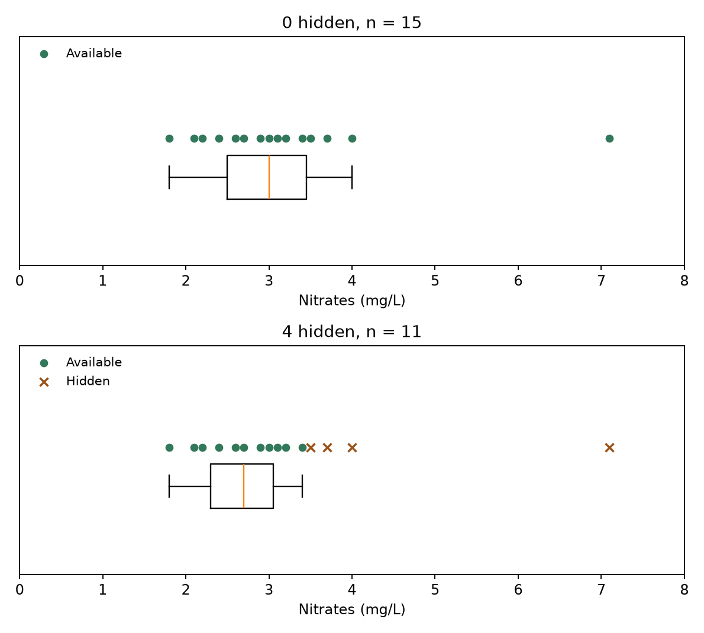
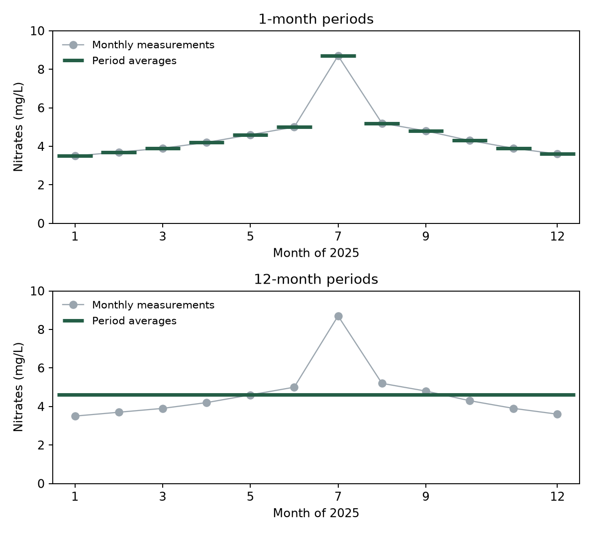
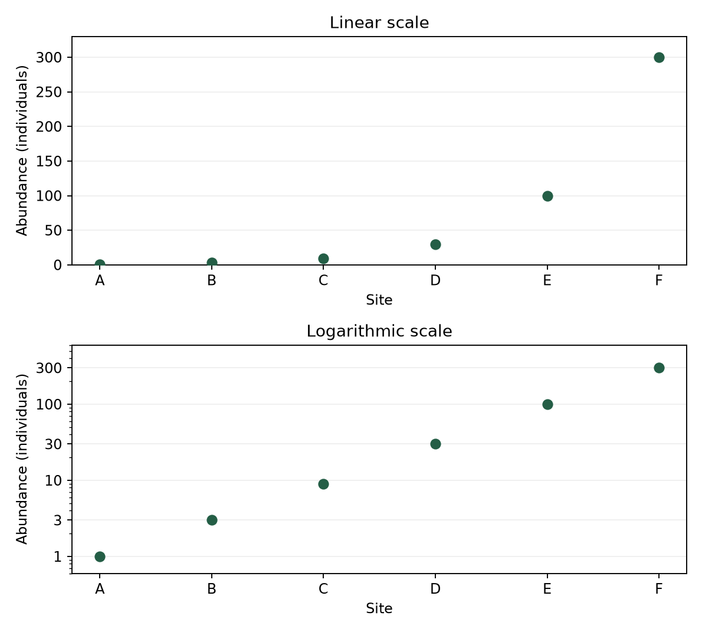

```{=html}
<div class="course-choices">
<nav class="course-language" aria-label="Course language"><a href="index-r.html" lang="fr" hreflang="fr">Français</a><span aria-current="page" lang="en">English</span></nav>
<nav class="course-code" aria-label="Programming language"><a href="index-en.html">Python</a><span aria-current="page">R</span></nav>
</div>
```

All the concepts in this session are covered in the videos. The accompanying texts summarise the main ideas and offer additional interactive animations. You can read them before or after watching, whichever works best for you. The videos are in French, with English subtitles selected by default on this page.

You will also find Python or R code examples to reuse and adapt in the practical session. You can run the code in a Jupyter notebook or RStudio, as appropriate, or simply read through it to understand the approach and adapt it to your own data.

# Introduction

In session 2, we learned to organise observations and summarise them with numbers. But a mean or a table does not always reveal what is happening in our data. Is a high concentration an isolated observation? Do all groups have similar values? Is there a change over time? Graphs help us explore these questions and share what we have understood.

We will learn to **choose a representation to suit a question**, read a boxplot, and examine relationships and changes over time. We will also see how a graph can be accurate yet give a misleading impression, depending on its scale, colours or choice of indicator.

# Video 1: Choosing a graph to suit the question

::: {.content-visible when-format="html"}
```{=html}
<div class="cours-video">
  <video id="video-s3v1" class="video-js vjs-big-play-centered" data-cours-video
         controls preload="metadata" playsinline
         aria-label="Video 1: Choosing a graph to suit the question">
    <source src="https://mediaserver.unige.ch/proxy/317775/LjUU37LGorXlQNAj.mp4?from_player=true" type="video/mp4">
    <track kind="subtitles" src="assets/video/sous-titres/S3V1.fr.vtt" srclang="fr" label="Français">
    <track kind="subtitles" src="assets/video/sous-titres/S3V1.en.vtt" srclang="en" label="English" default>
    <p>Your browser cannot display this video. Please use the Mediaserver link below.</p>
  </video>
  <div class="cours-video-erreur" role="status" hidden>
    <p>The video could not be loaded. Try again or open it on Mediaserver using the link below.</p>
    <button class="cours-video-reessayer" type="button">Try again</button>
  </div>
</div>
```
:::

[Watch the video on Mediaserver](https://mediaserver.unige.ch/play/317775).

## Monitoring water quality

Let us keep water quality as our running example, with a **different dataset**, the one used in this session's videos: [qualite_eau_visualisation.csv](data/qualite_eau_visualisation.csv). It describes four sites, each in a different catchment, visited once a month throughout 2025.

The **48 rows therefore represent observations at a particular site on a particular date**, not 48 distinct sites. The `site`, `bassin` and `date` columns identify them.

- `type_milieu` describes the habitat
- `classe_qualite` records an ordered category from “very good” to “poor”
- `nitrates_mg_l` and `oxygene_mg_l` are concentrations in mg/L
- `temperature_c` is temperature in °C.

This structure matters for interpretation, because visiting one site twelve times is not equivalent to visiting twelve independent sites.

## Choosing the variables

Let us start with the question: **“Which quality category occurs most often among the observations?”** We need an ordinal categorical variable, `classe_qualite`, and we want to compare the numbers of observations in its categories. We can count them while preserving their natural order:

::: {#cell-exemple-3-1-effectifs}

[]{#bloc-1}

```{r}
#| label: exemple-3-1-effectifs
# Block 1 : Counts
donnees <- read.csv("data/qualite_eau_visualisation.csv",
                    fileEncoding = "CP1252")
ordre <- c("très bonne", "bonne", "moyenne", "mauvaise")
effectifs <- table(factor(donnees$classe_qualite, levels = ordre))
print(effectifs)
cat("Missing categories:", sum(is.na(donnees$classe_qualite)), "\n")
```

:::

They add up to 48, with no missing categories. To compare the counts at a glance, we can represent them as bar lengths:

::: {#cell-exemple-3-1-barres}

[]{#bloc-2}

```{r}
#| label: exemple-3-1-barres
#| fig-width: 7
#| fig-height: 3.5
#| fig-alt: "Bar chart"
# Block 2 : Bar chart
barplot(effectifs, names.arg = c("Very good", "Good", "Moderate", "Poor"),
        col = "#32785a", xlab = "Quality category", ylab = "Count",
        main = "48 site visits")
```

:::

Each bar's position identifies the category and its length shows the count, while the order of the bars reflects the ranking of water quality. However, the distance between bars has no meaning.

We could also ask what **proportion of observations** falls in each category. We then divide the counts by the total number of observations with a known category:

::: {#cell-exemple-3-1-proportions}

[]{#bloc-3}

```{r}
#| label: exemple-3-1-proportions
# Block 3 : Percentages
pourcentages <- 100 * effectifs / sum(effectifs)
print(round(pourcentages, 1))
```

:::

The 20 “moderate” observations account for **41.7% of the 48 observations**. This does not mean that 41.7% of sites in the catchment have moderate water quality! We are counting visits, with repeated visits to each site.

## Distinguishing categories from numerical intervals

To examine the distribution of nitrate concentrations, we change both the variable and the question. We now count **numerical values** within **concentration intervals**, rather than quality categories. This brings us back to the histogram introduced in session 2.

**Reminder:** Histogram rectangles touch because their intervals follow one another on a numerical scale, unlike the bars in a bar chart. Their width has a quantitative meaning, such as 1 mg/L. With equal-width intervals, their height represents the number of observations in each interval.

Our file contains 48 known quality categories, but one nitrate concentration is missing. The histogram would therefore represent **47 concentrations**, not 48.

## Matching the representation to what we want to see

The same data table can answer several questions. The variables and the comparison we want to make guide our choice. This table provides a few pointers, although other options exist for each purpose:

| What we want to see | Variables needed | Possible representation |
| --- | --- | --- |
| Differences in counts | One categorical variable | Bar chart |
| A distribution | One numerical variable | Histogram |
| Differences in distributions | One numerical variable and a group | Points and boxplots |
| An association | Two numerical variables | Scatterplot |
| Change over time | A date and a measurement | Points joined in time order |

**To make graphs easier to read:**

- For precise comparisons, positions on a **common scale** and lengths are usually easier to read than circle areas.
- Colours and shapes can distinguish groups, provided we explain their meaning and do not rely on colour alone.
- When groups overlap, **facets**, or small panels showing the same kind of graph, can separate them while keeping comparable axes.

During data exploration, we can try several views to identify a pattern or an unusual observation. When communicating results, however, we choose the view that answers our question most clearly, with a title, named axes, units and a legend when needed.

# Video 2: Summarising a distribution and comparing groups

::: {.content-visible when-format="html"}
```{=html}
<div class="cours-video">
  <video id="video-s3v2" class="video-js vjs-big-play-centered" data-cours-video
         controls preload="metadata" playsinline
         aria-label="Video 2: Summarising a distribution and comparing groups">
    <source src="https://mediaserver.unige.ch/proxy/317776/VO237HwO41BQz65o.mp4?from_player=true" type="video/mp4">
    <track kind="subtitles" src="assets/video/sous-titres/S3V2.fr.vtt" srclang="fr" label="Français">
    <track kind="subtitles" src="assets/video/sous-titres/S3V2.en.vtt" srclang="en" label="English" default>
    <p>Your browser cannot display this video. Please use the Mediaserver link below.</p>
  </video>
  <div class="cours-video-erreur" role="status" hidden>
    <p>The video could not be loaded. Try again or open it on Mediaserver using the link below.</p>
    <button class="cours-video-reessayer" type="button">Try again</button>
  </div>
</div>
```
:::

[Watch the video on Mediaserver](https://mediaserver.unige.ch/play/317776).

## The boxplot

Let us return to nitrate concentrations. We could compare the sites in the four catchments by calculating a mean for each. But remember session 2: two series can have the same mean and very different spreads. A single extreme value can also shift the mean while the remaining observations stay close together.

A **boxplot** summarises both centre and spread. To understand it, imagine our concentrations arranged from smallest to largest. The median divides this ordered series into two halves. The first quartile, $Q_1$, marks approximately the first quarter of observations, and the third, $Q_3$, the first three quarters. The box extends from $Q_1$ to $Q_3$, with a line at the median.

The **interquartile range**, or $IQR$, is the distance between the two quartiles:

$$IQR = Q_3 - Q_1$$

It summarises the spread of the central half of the observations, in the same units as the data. A longer box indicates that the central observations are more spread out.

## Calculating quartiles from our observations

Take the nitrate measurements at the West site. We leave out only missing nitrate concentrations for this calculation and report how many values remain:

::: {#cell-exemple-3-2-quartiles}

[]{#bloc-4}

```{r}
#| label: exemple-3-2-quartiles
# Block 4 : Quartiles
donnees <- read.csv("data/qualite_eau_visualisation.csv",
                    fileEncoding = "CP1252")
mesures <- donnees$nitrates_mg_l[donnees$site == "O1"]
valeurs <- mesures[!is.na(mesures)]
cat("Available:", length(valeurs), "Missing:", sum(is.na(mesures)), "\n")
quartiles <- quantile(valeurs, c(0.25, 0.5, 0.75), type = 7)
q1 <- quartiles[1]
mediane <- quartiles[2]
q3 <- quartiles[3]
print(quartiles)
```

:::

There are 11 available concentrations from 12 visits. We obtain **$Q_1 = 2.90$, a median of $3.20$ and $Q_3 = 3.60$ mg/L**, giving an interquartile range of **0.70 mg/L**.

Quartiles can differ slightly according to sample size and the calculation convention used. Their role and meaning stay the same, but we need to use a consistent convention throughout an analysis.

## The whiskers

The box does not show the entire series. A common convention uses the fences $Q_1 - 1.5\,IQR$ and $Q_3 + 1.5\,IQR$ to locate observations outside the box. The whiskers reach the **most extreme observations within these fences**. They do not necessarily end at the calculated fences themselves!

::: {#cell-exemple-3-2-bornes}

[]{#bloc-5}

```{r}
#| label: exemple-3-2-bornes
# Block 5 : Whiskers
ecart_interquartile <- q3 - q1
borne_basse <- q1 - 1.5 * ecart_interquartile
borne_haute <- q3 + 1.5 * ecart_interquartile
interieur <- valeurs >= borne_basse & valeurs <= borne_haute
cat("Fences:", borne_basse, borne_haute, "mg/L\n")
cat("Whiskers (mg/L):", range(valeurs[interieur]), "\n")
cat("Flagged values (mg/L):", valeurs[!interieur], "\n")
```

:::

For the West site, the fences are 1.85 and 4.65 mg/L, and all available concentrations fall between them. The whiskers extend from **2.60 to 3.90 mg/L**, the actual observed extremes.

A value beyond the fences would be drawn separately as a point. It could be a recording error, but it could also be a real event worth studying: an unusual value is not automatically a value to remove!

## Comparing sites

Now place all four boxes on the same scale. We also display the available sample sizes, because a box alone does not show them:

::: {#cell-exemple-3-2-groupes}

[]{#bloc-6}

```{r}
#| label: exemple-3-2-groupes
#| fig-width: 7
#| fig-height: 3.5
#| fig-alt: "Compare sites"
# Block 6 : Compare sites
library(ggplot2)

donnees$site <- factor(donnees$site, levels = c("N1", "E1", "S1", "O1"))
mesures <- donnees[!is.na(donnees$nitrates_mg_l), ]
print(table(mesures$site))  # Available measurements
print(aggregate(nitrates_mg_l ~ site, data = mesures, FUN = median))
ggplot(mesures, aes(x = site, y = nitrates_mg_l)) +
  geom_boxplot() +
  labs(x = "Site", y = "Nitrates (mg/L)", title = "Four monitored sites")
```

:::

South has the highest median in this monitoring campaign. Its measurement of 8.7 mg/L is plotted separately, inviting us to examine that visit. These differences **describe only the collected measurements**. They do not yet establish a general difference between catchments, let alone identify a cause for it.

The whiskers also describe the spread of observations. **Beware of this common mistake: they are not confidence intervals or margins of error for the mean!** We will discuss uncertainty in estimation when we turn to **statistical inference**.

## What a summary can hide

Similar boxes can come from different sample sizes or distribution shapes. If we want to identify two clusters of values, individual points or a histogram can complement the summary. A **violin plot** shows an estimated density: wider regions indicate where observations are concentrated. Like a histogram, its appearance depends on smoothing and can visually suggest values that were never observed. With small samples like ours, looking at the individual points is especially useful.

::: {#cell-exemple-3-2-violon}

[]{#bloc-7}

```{r}
#| label: exemple-3-2-violon
#| fig-width: 7
#| fig-height: 3.5
#| fig-alt: "Violin and observations"
# Block 7 : Violin and observations
ggplot(mesures, aes(x = site, y = nitrates_mg_l)) +
  geom_violin(trim = TRUE) +  # Stop at the observed extremes
  geom_point(size = 1) +
  labs(x = "Site", y = "Nitrates (mg/L)",
       title = "Violin plots and available measurements")
```

:::

Missing data can also change what we see. The graph below uses a series of fifteen concentrations, separate from the four-site file, to show what happens if the highest values become unavailable. Before moving the slider, try to predict what will happen to the median and the box.

::: {.content-visible when-format="html"}
<iframe class="complement-animation" src="assets/interactifs/explorations.html?animation=absences&amp;lang=en" title="What does selective missingness change?" loading="lazy" style="display:block;width:100%;height:650px;border:0"></iframe>
:::

::: {.content-visible unless-format="html"}
{width=100%}
:::

When high values become unavailable, the box describes a different set of measurements. A lower median does not necessarily mean that water quality has improved. This shows why we should ask **which observations are missing and why**, rather than simply reporting the number of observations.

# Video 3: Reading relationships and communicating results

::: {.content-visible when-format="html"}
```{=html}
<div class="cours-video">
  <video id="video-s3v3" class="video-js vjs-big-play-centered" data-cours-video
         controls preload="metadata" playsinline
         aria-label="Video 3: Reading relationships and communicating results">
    <source src="https://mediaserver.unige.ch/proxy/317778/NRJuzwxus6KxEGDF.mp4?from_player=true" type="video/mp4">
    <track kind="subtitles" src="assets/video/sous-titres/S3V3.fr.vtt" srclang="fr" label="Français">
    <track kind="subtitles" src="assets/video/sous-titres/S3V3.en.vtt" srclang="en" label="English" default>
    <p>Your browser cannot display this video. Please use the Mediaserver link below.</p>
  </video>
  <div class="cours-video-erreur" role="status" hidden>
    <p>The video could not be loaded. Try again or open it on Mediaserver using the link below.</p>
    <button class="cours-video-reessayer" type="button">Try again</button>
  </div>
</div>
```
:::

[Watch the video on Mediaserver](https://mediaserver.unige.ch/play/317778).

## Scatterplots

Let us now consider temperature and dissolved oxygen. Each complete observation provides a pair: temperature on the horizontal axis and oxygen concentration on the vertical axis. We keep only rows where **both measurements are available**.

::: {#cell-exemple-3-3-nuage}

[]{#bloc-8}

```{r}
#| label: exemple-3-3-nuage
#| fig-width: 7
#| fig-height: 3.5
#| fig-alt: "Scatterplot"
# Block 8 : Scatterplot
donnees <- read.csv("data/qualite_eau_visualisation.csv",
                    fileEncoding = "CP1252")
colonnes <- c("temperature_c", "oxygene_mg_l")
paires <- donnees[complete.cases(donnees[colonnes]), colonnes]
cat("Complete pairs:", nrow(paires), "Excluded:", nrow(donnees) - nrow(paires), "\n")
plot(paires$temperature_c, paires$oxygene_mg_l,
     pch = 16, col = adjustcolor("steelblue", alpha.f = 0.65),
     xlab = "Temperature (°C)", ylab = "Oxygen (mg/L)",
     main = "Temperature and oxygen: observations")
```

:::

The graph uses 47 pairs from 48 observations. In these data, oxygen concentrations tend to be lower at higher temperatures. This is a **negative association**: “negative” describes its direction and **does not mean that there is no association**! Conversely, a “positive” association means that the two variables tend to increase or decrease together.

To read the scatterplot, we also examine its shape, the spread around the trend, groups and isolated points. Points following a curve cannot be summarised in quite the same way as points close to a straight line. Colours and shapes for each catchment, or facets with identical axes, would help us examine whether the trend is present at every site or only at some of them.

This association is not enough to establish **causality**! Other factors may be involved: season, flow or biological activity can affect both measurements. Repeated visits may also share a common context. The graph helps us formulate hypotheses, but describing a causal mechanism requires considering the study design and alternative explanations.

Several observations can also hide behind one visible point. In that case, smaller symbols and transparency help reveal overlap. With many observations, a grid coloured by counts can be easier to read. Its legend must explicitly state that colour represents a **number of observations**, not a concentration.

::: {#cell-exemple-3-3-grille}

[]{#bloc-9}

```{r}
#| label: exemple-3-3-grille
#| fig-width: 7
#| fig-height: 3.5
#| fig-alt: "Count grid"
# Block 9 : Count grid
library(ggplot2)

# Cells: 2 °C wide and 1 mg/L high
limites_x <- seq(4, 26, by = 2)
limites_y <- 5:13
ggplot(paires, aes(x = temperature_c, y = oxygene_mg_l)) +
  geom_bin_2d(breaks = list(x = limites_x, y = limites_y),
              closed = "left", drop = FALSE) +
  scale_fill_gradient(low = "aliceblue", high = "navy") +
  labs(x = "Temperature (°C)", y = "Oxygen (mg/L)",
       fill = "Number of observations", title = "47 pairs grouped into cells")
```

:::

## Changes over time and visible gaps

A boxplot does not tell us when values were measured. To follow nitrates throughout the year, we return to the dates and put them in order. Here we look at the series for the West site:

::: {#cell-exemple-3-3-donnees}

[]{#bloc-10}

```{r}
#| label: exemple-3-3-donnees
# Block 10 : Prepare dates
donnees$date <- as.Date(donnees$date, format = "%d.%m.%Y")
serie <- donnees[donnees$site == "O1", c("date", "nitrates_mg_l")]
serie <- serie[order(serie$date), ]
print(serie$date[is.na(serie$nitrates_mg_l)])
```

:::

The September visit has a row in the table, but its nitrate concentration is missing. The graph should therefore show a break, instead of connecting August to October as though the monitoring record were complete.

[]{#cell-exemple-3-3-points}

::: {#cell-exemple-3-3-ligne}

[]{#bloc-11}

```{r}
#| label: exemple-3-3-ligne
#| fig-width: 7
#| fig-height: 3.5
#| fig-alt: "Time series"
# Block 11 : Time series
plot(serie$date, serie$nitrates_mg_l, type = "o", pch = 16,
     xlab = "Date", ylab = "Nitrates (mg/L)",
     main = "West site: no nitrate measurement in September")
```

:::

The points represent available measurements and the lines guide us between successive dates. The September break makes the missing measurement visible. If a date were missing entirely from the table, we would need to insert it with a missing value to show this break. Otherwise, a line would connect the August and October observations.

How we group time also matters. The next exploration uses the **twelve complete measurements at the South site**. Compare the monthly series with averages over longer periods. Is the peak still as visible?

::: {.content-visible when-format="html"}
<iframe class="complement-animation" src="assets/interactifs/explorations.html?animation=temps&amp;lang=en" title="What can averaging over time hide?" loading="lazy" style="display:block;width:100%;height:650px;border:0"></iframe>
:::

::: {.content-visible unless-format="html"}
{width=100%}
:::

Averaging several months reduces the July peak, even though the values used in the calculation have not changed! A smoother curve can therefore result from grouping the data rather than from a more stable phenomenon. The period should suit our question: for example, describing the year's average level does not require the same detail as identifying a short-lived event.

## Scales and colours

A **linear scale** gives equal distances to **equal differences**. A **logarithmic scale** gives equal distances to **equal ratios**: moving from 1 to 10 covers the same distance as moving from 10 to 100. It helps compare values spanning several orders of magnitude. Our concentrations do not require this change. **Remember:** a logarithmic scale requires strictly positive values and must always be clearly labelled, otherwise the graph may mislead readers.

::: {.content-visible when-format="html"}
<iframe class="complement-animation" src="assets/interactifs/explorations.html?animation=echelles&amp;lang=en" title="Change the scale, keep the data" loading="lazy" style="display:block;width:100%;height:650px;border:0"></iframe>
:::

::: {.content-visible unless-format="html"}
{width=100%}
:::

Colour can also encode a measurement. In a **heatmap**, each cell represents a combination, such as a site and a month, and its colour shows a concentration. An ordered light-to-dark palette can help readers follow low and high values. However, missing values should always have a distinct colour so they cannot be mistaken for the lowest concentrations.

## Communicating without overstating what we observe

In a bar chart, lengths must be compared **from zero**. Truncating this axis can mislead someone who does not notice the scale. A scatterplot or line chart, however, may use an axis that does not start at zero, provided its limits are explicit and appropriate for the question. When comparing groups across several panels, a common scale is generally preferable.

Two vertical axes can help bring together information measured on different scales within one graph, but the visual interpretation can also be misleading. Sometimes, two panels aligned in time are easier to interpret.

::: {#cell-exemple-3-3-doubleaxes}

[]{#bloc-12}

```{r}
#| label: exemple-3-3-doubleaxes
#| fig-width: 7
#| fig-height: 3.5
#| fig-alt: "Two vertical axes"
# Block 12 : Two vertical axes
nord <- donnees[donnees$site == "N1", ]
nord <- nord[order(nord$date), ]
cat("Visits:", nrow(nord), "\n")  # 12 complete pairs at this site
par(mar = c(5, 4, 3, 4))  # Space for both vertical axes
plot(nord$date, nord$temperature_c, type = "o", col = "darkred",
     xlab = "Date", ylab = "Temperature (°C), solid line",
     main = "North site: two vertical scales")
par(new = TRUE)  # Overlay the second series
plot(nord$date, nord$oxygene_mg_l, type = "o", pch = 15, lty = 2,
     col = "navy", axes = FALSE, xlab = "", ylab = "")
axis(4, col.axis = "navy")
mtext("Oxygen (mg/L), dashed line", side = 4, line = 2.5)
par(new = FALSE)
```

:::

A graph is above all a way to reveal a pattern, accompanied by text and a legend explaining its meaning. It guides and supports our statistical reasoning by helping us understand what is happening in our data quickly and easily.

An appropriate conclusion for our scatterplot would be: **“In these 47 complete observations, oxygen concentrations tend to be lower at higher temperatures.”** It states what we observe without claiming to establish a cause or generalising these findings to all waters in the catchment.

**Remember:** before sharing a figure, always check that:

- the research question is easy to identify
- units and sample sizes are clear
- subgroups and missing values are visible
- the title, axis labels and legend, if needed, are present.

# Questions about this session {#questions-session-03}

If a concept is still unclear, you would like to explore an example further, or you have any other question, feel free to ask it in the SpeakUp space below (anonymously or not). Take a moment to read other students' questions and vote for those you would like answered. Sorting by votes brings the questions of greatest interest to the group to the top. We will answer some questions directly on the platform and discuss others during our next in-person session.

This space is shared by the French and English versions of the course and by students using Python or R. If your question is about code, mention the language you are using and the example you are working on.

::: {.content-visible when-format="html"}
<iframe class="speakup-room" src="https://web.speakup.info/room/join/37728?theme=UniGE&amp;lang=en" title="SpeakUp: questions and votes for session 3, room 37728" loading="lazy" style="display:block;width:100%;height:clamp(480px,80vh,760px);border:1px solid #ccd6dc;border-radius:6px"></iframe>

If the room does not appear within this page, use the link below.
:::

[Open the SpeakUp room for session 3](https://web.speakup.info/room/join/37728?theme=UniGE&lang=en){target="_blank" rel="noopener"}. **Room code: 37728.**
