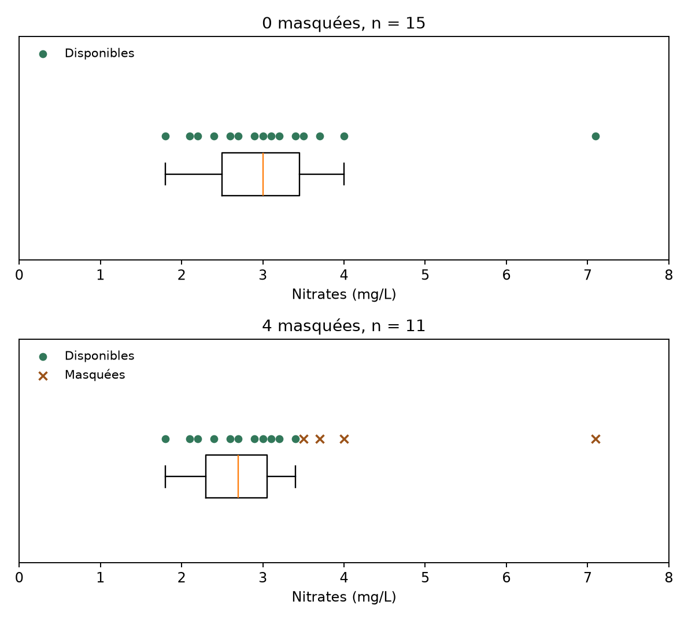
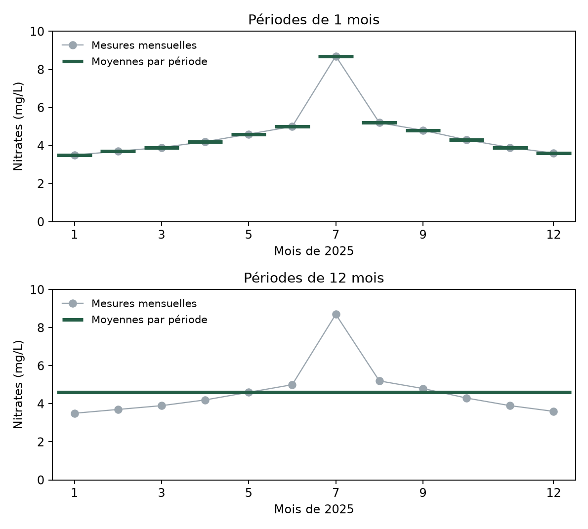
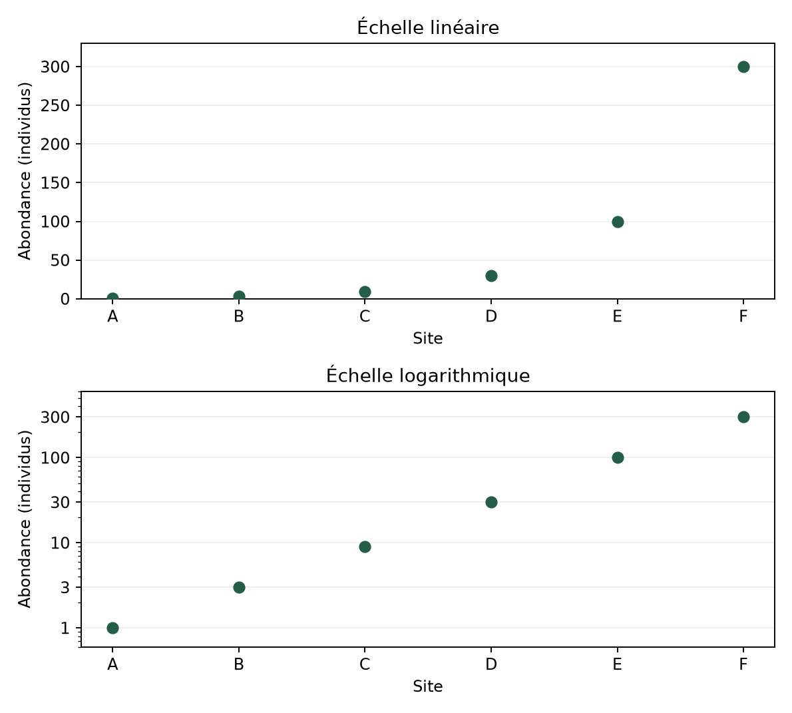

```{=html}
<div class="course-choices">
<nav class="course-language" aria-label="Langue du cours"><span aria-current="page" lang="fr">Français</span><a href="index-en.html" lang="en" hreflang="en">English</a></nav>
<nav class="course-code" aria-label="Langage des exemples"><span aria-current="page">Python</span><a href="index-r.html">R</a></nav>
</div>
```

Toutes les notions de la session sont entièrement présentées dans les vidéos. Les textes qui les accompagnent sont là pour en résumer le contenu et proposer des animations complémentaires. Vous pouvez les lire avant ou après la vidéo, selon vos préférences.

Vous y trouverez également des exemples de code en Python ou R à reprendre et à adapter lors du TP. Les blocs de code sont exécutables dans un carnet Jupyter ou dans R-Studio, mais vous pouvez aussi les lire pour comprendre la logique et les adapter à vos propres données.

# Introduction de la session

Dans la session 2, nous avons appris à organiser des observations et à les résumer avec des nombres. Mais une moyenne ou un tableau ne nous permettent pas toujours de voir ce qui se passe dans nos données. Une concentration élevée est-elle isolée ? Retrouve-t-on les mêmes valeurs dans tous les groupes ? Y a-t-il une évolution au fil des mois ? Les graphiques nous aident à explorer ces questions, puis à partager ce que nous avons compris.

Nous allons apprendre à **choisir une représentation en fonction d'une question**, à lire une boîte à moustaches et à examiner des relations ou des évolutions. Nous verrons aussi qu'un graphique peut être exact tout en donnant une impression trompeuse, selon l'échelle, les couleurs ou l'indicateur retenus.

# Vidéo 1 : Choisir un graphique selon la question

::: {.content-visible when-format="html"}
```{=html}
<div class="cours-video">
  <video id="video-s3v1" class="video-js vjs-big-play-centered" data-cours-video
         controls preload="metadata" playsinline
         aria-label="Vidéo 1 : Choisir un graphique selon la question">
    <source src="https://mediaserver.unige.ch/proxy/317775/LjUU37LGorXlQNAj.mp4?from_player=true" type="video/mp4">
    <track kind="subtitles" src="assets/video/sous-titres/S3V1.fr.vtt" srclang="fr" label="Français" default>
    <track kind="subtitles" src="assets/video/sous-titres/S3V1.en.vtt" srclang="en" label="English">
    <p>Votre navigateur ne peut pas afficher cette vidéo. Utilisez le lien Mediaserver ci-dessous.</p>
  </video>
  <div class="cours-video-erreur" role="status" hidden>
    <p>La vidéo n'a pas pu être chargée. Vous pouvez réessayer ou l'ouvrir sur Mediaserver avec le lien ci-dessous.</p>
    <button class="cours-video-reessayer" type="button">Réessayer</button>
  </div>
</div>
```
:::

[Regarder la vidéo sur Mediaserver](https://mediaserver.unige.ch/play/317775).

## Suivi de la qualité de l'eau

Gardons notre fil rouge de la qualité de l'eau, avec un **autre jeu de données**, celui utilisé dans les vidéos de cette session : [qualite_eau_visualisation.csv](data/qualite_eau_visualisation.csv). Il décrit quatre sites, chacun situé dans un bassin différent, suivis une fois par mois pendant l'année 2025.

Les **48 lignes correspondent donc à des observations « site à une date donnée »**, pas à 48 sites distincts. Les colonnes `site`, `bassin` et `date` permettent de les identifier.

- `type_milieu` décrit le milieu
- `classe_qualite` indique une catégorie ordonnée de « très bonne » à « mauvaise »
- `nitrates_mg_l` et `oxygene_mg_l` sont des concentrations en mg/L
- `temperature_c` est une température en °C.

Cette organisation est importante pour l'interprétation, car visiter douze fois un même site n'est pas équivalent à visiter douze sites indépendants.

## Choisir les variables

Commençons par la question : **« Quelle classe de qualité est la plus fréquente parmi les observations ? »** Nous avons besoin d'une variable catégorielle ordinale, `classe_qualite`, et nous souhaitons comparer les nombres d'observations de ses catégories. Comptons-les en conservant leur ordre naturel :

::: {#cell-exemple-3-1-effectifs}

[]{#bloc-1}

```{python}
#| label: exemple-3-1-effectifs
# Bloc 1 : Effectifs
import pandas as pd
import matplotlib.pyplot as plt

donnees = pd.read_csv("data/qualite_eau_visualisation.csv", encoding="cp1252")
ordre = ["très bonne", "bonne", "moyenne", "mauvaise"]
effectifs = donnees["classe_qualite"].value_counts()
effectifs = effectifs.reindex(ordre, fill_value=0)
print(effectifs)
print("Classes manquantes :", donnees["classe_qualite"].isna().sum())
```

:::

Le total est bien de 48, et aucune classe n'est manquante. Pour comparer rapidement les effectifs, nous pouvons les représenter par les longueurs de barres :

[]{#bloc-2}

```{python}
#| label: exemple-3-1-barres
#| fig-width: 7
#| fig-height: 3.5
#| fig-alt: "Diagramme en barres"
# Bloc 2 : Diagramme en barres
fig, ax = plt.subplots(figsize=(6, 3))
ax.bar(["Très bonne", "Bonne", "Moyenne", "Mauvaise"], effectifs, color="#32785a")
ax.set(xlabel="Classe de qualité", ylabel="Effectif", title="48 visites ")
plt.tight_layout()
plt.show()
```

Ici, la position de chaque barre indique la catégorie et sa longueur indique l'effectif, et l'ordre des barres traduit l'ordre de la qualité. Par contre, il n'y a pas de signification à la distance entre les barres.

Nous pourrions aussi demander quelle **part des observations** relève de chaque classe. Il suffit alors de diviser les effectifs par le nombre total d’observations dont la classe est renseignée :

::: {#cell-exemple-3-1-proportions}

[]{#bloc-3}

```{python}
#| label: exemple-3-1-proportions
# Bloc 3 : Pourcentages
pourcentages = 100 * effectifs / effectifs.sum()
print(pourcentages.round(1))
```

:::

Les 20 observations de qualité « moyenne » représentent ainsi **41,7 % des 48 observations**. Cela ne signifie pas que 41,7 % des sites du bassin ont cette qualité ! Car nous comptons ici des visites, avec plusieurs visites par site.

## Distinguer catégories et intervalles numériques

Pour étudier la répartition des concentrations en nitrates, nous changeons de variable et de question. Nous ne comptons plus des catégories de qualité, mais des **valeurs numériques** dans des **intervalles de concentration**. Et donc nous retrouvons l'histogramme, introduit à la session 2.

**Rappel :** Les rectangles d'un histogramme se touchent parce que les intervalles se suivent sur une échelle numérique (contrairement à un diagramme en barres). Leur largeur a un sens quantitatif, par exemple 1 mg/L. Avec des intervalles de même largeur, leur hauteur représente l'effectif de chaque intervalle.

Dans notre fichier, les 48 classes de qualité sont connues, mais une concentration en nitrates manque. L'histogramme représenterait donc **47 concentrations** et non 48.

## Faire correspondre la représentation à ce que l'on cherche

Un même tableau de données permet d'aborder plusieurs questions, ce sont les variables et la comparaison souhaitée qui nous guident (ce tableau fournit seulement quelques repères, d'autres options existent pour chaque objectif) :

| Ce que nous cherchons | Variables utiles | Représentation possible |
| --- | --- | --- |
| Comparer des effectifs | Une variable catégorielle | Diagramme en barres |
| Voir une distribution | Une variable numérique | Histogramme |
| Comparer des distributions | Une variable numérique et un groupe | Points et boîtes à moustaches |
| Observer une association | Deux variables numériques | Nuage de points |
| Suivre une évolution | Une date et une mesure | Points reliés dans l'ordre temporel |

**Au niveau de la lisibilité des graphiques :**

- Pour comparer précisément, les positions sur une **échelle commune** et les longueurs sont généralement plus faciles à lire que les surfaces de cercles.
- La couleur et la forme peuvent distinguer les groupes, à condition d'en expliquer le sens et de ne pas compter uniquement sur la couleur.
- Quand les groupes se superposent, des **facettes**, c'est-à-dire plusieurs petits graphiques de même type, permettent de les séparer tout en conservant des axes comparables.

Pendant l'exploration des données, nous pouvons essayer plusieurs vues pour repérer une structure ou une observation inhabituelle. Par contre, pour communiquer, nous choisirons celle qui répond le plus clairement à notre question, avec un titre, des axes nommés, des unités et une légende lorsque celle-ci est nécessaire.

# Vidéo 2 : Résumer une distribution et comparer des groupes

::: {.content-visible when-format="html"}
```{=html}
<div class="cours-video">
  <video id="video-s3v2" class="video-js vjs-big-play-centered" data-cours-video
         controls preload="metadata" playsinline
         aria-label="Vidéo 2 : Résumer une distribution et comparer des groupes">
    <source src="https://mediaserver.unige.ch/proxy/317776/VO237HwO41BQz65o.mp4?from_player=true" type="video/mp4">
    <track kind="subtitles" src="assets/video/sous-titres/S3V2.fr.vtt" srclang="fr" label="Français" default>
    <track kind="subtitles" src="assets/video/sous-titres/S3V2.en.vtt" srclang="en" label="English">
    <p>Votre navigateur ne peut pas afficher cette vidéo. Utilisez le lien Mediaserver ci-dessous.</p>
  </video>
  <div class="cours-video-erreur" role="status" hidden>
    <p>La vidéo n'a pas pu être chargée. Vous pouvez réessayer ou l'ouvrir sur Mediaserver avec le lien ci-dessous.</p>
    <button class="cours-video-reessayer" type="button">Réessayer</button>
  </div>
</div>
```
:::

[Regarder la vidéo sur Mediaserver](https://mediaserver.unige.ch/play/317776).

## La boîte à moustaches (*boxplot*)

Reprenons les concentrations en nitrates. Pour comparer les sites des quatre bassins, nous pourrions calculer une moyenne par site. Mais souvenez-vous de la session 2 : deux séries peuvent avoir la même moyenne et pour autant avoir des dispersions très différentes. Une seule valeur extrême peut aussi déplacer la moyenne alors que les autres observations restent proches les unes des autres.

La **boîte à moustaches**, ou _boxplot_, propose un résumé du centre et de la dispersion. Pour la comprendre, imaginons nos concentrations rangées de la plus petite à la plus grande. La médiane partage cette série ordonnée en deux moitiés. Le premier quartile, $Q_1$, repère approximativement le premier quart des observations, et le troisième, $Q_3$, les trois premiers quarts. La boîte s'étend alors de $Q_1$ à $Q_3$, avec un trait à la médiane.

L'**écart interquartile**, noté $IQR$, correspond à la distance entre ces quartiles :

$$IQR = Q_3 - Q_1$$

Il résume la dispersion de la moitié centrale des observations et s'exprime dans la même unité que les données. Une boîte plus étendue indique que cette partie centrale est plus dispersée.

## Calculer les quartiles sur nos observations

Prenons les nitrates du site Ouest. Nous écartons uniquement les concentrations manquantes pour ce calcul, en indiquant combien de valeurs restent disponibles :

::: {#cell-exemple-3-2-quartiles}

[]{#bloc-4}

```{python}
#| label: exemple-3-2-quartiles
# Bloc 4 : Quartiles
import pandas as pd
import matplotlib.pyplot as plt

donnees = pd.read_csv("data/qualite_eau_visualisation.csv", encoding="cp1252")
ouest = donnees[donnees["site"] == "O1"]
valeurs = ouest["nitrates_mg_l"].dropna()
print("Disponibles :", len(valeurs), "Manquantes :", len(ouest) - len(valeurs))
q1 = valeurs.quantile(0.25)
mediane = valeurs.median()
q3 = valeurs.quantile(0.75)
print("Q1, médiane, Q3 (mg/L) :", round(q1, 2), round(mediane, 2), round(q3, 2))
```

:::

Sur les 12 visites, 11 concentrations sont disponibles. Nous obtenons **$Q_1 = 2{,}90$, une médiane de $3{,}20$ et $Q_3 = 3{,}60$ mg/L**, soit un écart interquartile de **0,70 mg/L**.

Selon l'effectif et la convention utilisée, les valeurs des quartiles peuvent légèrement varier. Cela ne change pas leur rôle et leur signification, mais il faut bien faire attention à conserver la même convention dans toute l'analyse.

## Les moustaches

La boîte ne montre pas toute la série : pour situer les observations qui l'entourent, une convention courante est d'utiliser les bornes $Q_1 - 1{,}5\,IQR$ et $Q_3 + 1{,}5\,IQR$. Les moustaches vont jusqu'aux **observations les plus extrêmes à l'intérieur de ces bornes**. Elles ne s'arrêtent donc pas nécessairement aux bornes calculées !

::: {#cell-exemple-3-2-bornes}

[]{#bloc-5}

```{python}
#| label: exemple-3-2-bornes
# Bloc 5 : Moustaches
ecart_interquartile = q3 - q1
borne_basse = q1 - 1.5 * ecart_interquartile
borne_haute = q3 + 1.5 * ecart_interquartile
interieur = valeurs.between(borne_basse, borne_haute)
print("Bornes (mg/L) :", round(borne_basse, 2), round(borne_haute, 2))
print("Moustaches (mg/L) :", valeurs[interieur].min(), valeurs[interieur].max())
```

:::

Pour le site Ouest, les bornes sont 1,85 et 4,65 mg/L, et toutes les concentrations disponibles sont comprises entre ces bornes. Les moustaches vont de **2,60 à 3,90 mg/L**, qui sont les valeurs extrêmes effectivement observées.

Une valeur au-delà des bornes serait représentée séparément, simplement par un point. Il pourrait s'agir d'une erreur de saisie, mais aussi d'un événement réel intéressant, car une valeur inhabituelle n'est pas automatiquement une valeur à supprimer !

## Comparer les sites

Plaçons maintenant les quatre boîtes sur une même échelle. Nous affichons aussi les effectifs disponibles, car la boîte seule ne les indique pas :

[]{#bloc-6}

```{python}
#| label: exemple-3-2-groupes
#| fig-width: 7
#| fig-height: 3.5
#| fig-alt: "Comparer les sites"
# Bloc 6 : Comparer les sites
import seaborn as sns

sites = ["N1", "E1", "S1", "O1"]
resume = donnees.groupby("site")["nitrates_mg_l"].agg(["count", "median"])
print(resume.reindex(sites))  # count : mesures disponibles
plt.figure(figsize=(6, 3))
sns.boxplot(data=donnees, x="site", y="nitrates_mg_l", order=sites)
plt.xlabel("Site")
plt.ylabel("Nitrates (mg/L)")
plt.title("Quatre sites de suivi")
plt.tight_layout()
plt.show()
```

Le site Sud présente la médiane la plus élevée dans ce suivi. Sa mesure de 8,7 mg/L apparaît à part, ce qui nous invite à examiner cette visite. Ces différences **décrivent les mesures recueillies uniquement**, mais ne permettent pas encore de démontrer qu'il existe une différence générale entre les bassins, et encore moins de trouver une cause à cette différence.

Les moustaches décrivent elles aussi la dispersion des observations. **Attention à cette erreur commune : elles ne sont pas des intervalles de confiance ni des marges d'erreur sur la moyenne !** Nous aborderons l'incertitude liée à l'estimation lorsque nous ferons de l'**inférence statistique**.

## Ce que le résumé peut masquer

Deux boîtes semblables peuvent correspondre à des effectifs ou à des formes de distribution différents. Si nous voulons repérer deux amas de valeurs, on peut compléter ce résumé grâce aux points individuels ou à un histogramme. Le **violon** représente quant à lui une densité estimée : les zones larges indiquent où les observations se concentrent mais, tout comme l'histogramme, son contour dépend du lissage choisi, et peut suggérer visuellement la présence de valeurs que nous n'avons pas observées. Avec de petits effectifs comme ici, regarder les points reste particulièrement utile.

[]{#bloc-7}

```{python}
#| label: exemple-3-2-violon
#| fig-width: 7
#| fig-height: 3.5
#| fig-alt: "Violon et observations"
# Bloc 7 : Violon et observations
plt.figure(figsize=(6, 3))
sns.violinplot(data=donnees, x="site", y="nitrates_mg_l", order=sites,
               inner=None, cut=0)  # Arrêter aux extrêmes observés
sns.stripplot(data=donnees, x="site", y="nitrates_mg_l", order=sites,
              color="black", size=3, jitter=False)
plt.xlabel("Site")
plt.ylabel("Nitrates (mg/L)")
plt.title("Violons et mesures disponibles")
plt.tight_layout()
plt.show()
```

Les données manquantes peuvent aussi modifier ce que nous voyons. Dans le graphique ci-dessous, une série de quinze concentrations (distincte du fichier des quatre sites) est utilisée pour montrer ce qui se passe si les données les plus élevées deviennent indisponibles. Avant de déplacer le curseur, essayez de prévoir ce que deviendront la médiane et la boîte.

::: {.content-visible when-format="html"}
<iframe class="complement-animation" src="assets/interactifs/explorations.html?animation=absences&amp;lang=fr" title="Que change une absence sélective ?" loading="lazy" style="display:block;width:100%;height:650px;border:0"></iframe>
:::

::: {.content-visible unless-format="html"}
{width=100%}
:::

Quand les fortes valeurs deviennent indisponibles, la boîte décrit un ensemble de mesures différent. Une médiane plus basse ne signifie donc pas nécessairement que la qualité de l'eau s'est améliorée. Cela montre pourquoi il faut chercher **quelles observations manquent et pour quelle raison**, plutôt que de simplement indiquer le nombre d'observations.

# Vidéo 3 : Lire les relations et communiquer les résultats

::: {.content-visible when-format="html"}
```{=html}
<div class="cours-video">
  <video id="video-s3v3" class="video-js vjs-big-play-centered" data-cours-video
         controls preload="metadata" playsinline
         aria-label="Vidéo 3 : Lire les relations et communiquer les résultats">
    <source src="https://mediaserver.unige.ch/proxy/317778/NRJuzwxus6KxEGDF.mp4?from_player=true" type="video/mp4">
    <track kind="subtitles" src="assets/video/sous-titres/S3V3.fr.vtt" srclang="fr" label="Français" default>
    <track kind="subtitles" src="assets/video/sous-titres/S3V3.en.vtt" srclang="en" label="English">
    <p>Votre navigateur ne peut pas afficher cette vidéo. Utilisez le lien Mediaserver ci-dessous.</p>
  </video>
  <div class="cours-video-erreur" role="status" hidden>
    <p>La vidéo n'a pas pu être chargée. Vous pouvez réessayer ou l'ouvrir sur Mediaserver avec le lien ci-dessous.</p>
    <button class="cours-video-reessayer" type="button">Réessayer</button>
  </div>
</div>
```
:::

[Regarder la vidéo sur Mediaserver](https://mediaserver.unige.ch/play/317778).

## Nuage de points

Intéressons-nous maintenant à la température et à l'oxygène dissous. Chaque observation complète nous fournit une paire : une température sur l'axe horizontal et une concentration en oxygène sur l'axe vertical. Nous conservons uniquement les lignes où ces **deux mesures sont disponibles**.

[]{#bloc-8}

```{python}
#| label: exemple-3-3-nuage
#| fig-width: 7
#| fig-height: 3.5
#| fig-alt: "Nuage de points"
# Bloc 8 : Nuage de points
import pandas as pd
import matplotlib.pyplot as plt

donnees = pd.read_csv("data/qualite_eau_visualisation.csv", encoding="cp1252")
colonnes = ["temperature_c", "oxygene_mg_l"]
paires = donnees[colonnes].dropna()
print("Paires complètes :", len(paires), "Exclues :", len(donnees) - len(paires))
fig, ax = plt.subplots(figsize=(6, 3))
ax.scatter(paires["temperature_c"], paires["oxygene_mg_l"], alpha=0.65, s=25)
ax.set(xlabel="Température (°C)", ylabel="Oxygène (mg/L)",
       title="Température et oxygène : observations ")
plt.tight_layout()
plt.show()
```

Le graphique utilise 47 paires sur 48 observations. Dans ces données, les concentrations en oxygène tendent à être plus faibles lorsque les températures sont élevées. C’est une **association négative** : « négative » décrit la direction de l'association, cela ne **signifie pas qu’il n’y a pas d’association** ! À l'inverse, une association dite « positive » indique que les deux variables augmentent ou diminuent de manière conjointe.

Pour lire le nuage, regardons aussi sa forme, la dispersion autour de la tendance, les groupes et les points isolés. Un ensemble de points suivant une courbe ne se résume pas de la même façon qu’un ensemble proche d’une droite. Des couleurs et des formes par bassin, ou des facettes avec des axes identiques, aideraient à examiner si la tendance se retrouve dans chaque site ou uniquement chez quelques-uns.

Cette association ne suffit pas à conclure à une **causalité** ! D'autres facteurs peuvent jouer : par exemple la saison, le débit ou l’activité biologique peuvent influencer les deux mesures. Nos visites répétées peuvent également partager un même contexte. Le graphique nous aide à formuler des hypothèses, mais décrire un mécanisme causal demande de réfléchir au protocole et aux autres explications possibles.

Enfin, plusieurs observations peuvent se cacher derrière un seul point visible. Dans ce cas, réduire la taille des symboles et ajouter de la transparence aide à repérer ces superpositions. Pour beaucoup de données, une grille dont la couleur représente les effectifs peut être plus lisible. La légende doit alors explicitement indiquer qu’elle représente un **nombre d’observations** et non pas une concentration.

[]{#bloc-9}

```{python}
#| label: exemple-3-3-grille
#| fig-width: 7
#| fig-height: 3.5
#| fig-alt: "Grille des effectifs"
# Bloc 9 : Grille des effectifs
plt.figure(figsize=(6, 3))
# Cellules : largeur de 2 °C et hauteur de 1 mg/L
plt.hist2d(paires["temperature_c"], paires["oxygene_mg_l"],
           bins=[range(4, 27, 2), range(5, 14)], cmap="Blues")
plt.colorbar(label="Nombre d’observations")
plt.xlabel("Température (°C)")
plt.ylabel("Oxygène (mg/L)")
plt.title("47 paires regroupées en cellules")
plt.tight_layout()
plt.show()
```

## Évolution temporelle et rendre les lacunes visibles

Une boîte à moustaches ne nous dit pas quand les valeurs ont été mesurées : pour suivre les nitrates au cours de l’année, revenons aux dates et rangeons-les dans l’ordre. Ici, nous regardons la série du site Ouest :

::: {#cell-exemple-3-3-donnees}

[]{#bloc-10}

```{python}
#| label: exemple-3-3-donnees
# Bloc 10 : Préparer les dates
donnees["date"] = pd.to_datetime(donnees["date"], dayfirst=True)
serie = donnees[donnees["site"] == "O1"]
serie = serie.sort_values("date")
print(serie[["date", "nitrates_mg_l"]])  # Conserver la valeur manquante
```

:::

La visite de septembre figure dans le tableau, mais sa concentration en nitrates est absente. Alors dans le graphique, on doit faire attention à montrer une interruption plutôt que de relier août et octobre comme si le suivi était complet.

[]{#cell-exemple-3-3-points}

[]{#bloc-11}

```{python}
#| label: exemple-3-3-ligne
#| fig-width: 7
#| fig-height: 3.5
#| fig-alt: "Série temporelle"
# Bloc 11 : Série temporelle
plt.figure(figsize=(6, 3))
plt.plot(serie["date"], serie["nitrates_mg_l"], "o-")
plt.xlabel("Date")
plt.ylabel("Nitrates (mg/L)")
plt.title("Site Ouest : nitrates manquants en septembre")
plt.xticks(rotation=45)
plt.tight_layout()
plt.show()
```

Les points correspondent aux mesures disponibles et les lignes nous guident dans la lecture entre les dates successives. En septembre, la coupure permet de rendre l'absence de donnée visible. Si une date était entièrement absente du tableau, il faudrait la réintroduire avec une valeur manquante pour afficher cette interruption, sinon une ligne aurait relié l'observation d'août avec celle d'octobre.

La manière de regrouper le temps compte elle aussi. Dans l’exploration suivante, nous utilisons les **douze mesures complètes du site Sud**. Comparez la série mensuelle à des moyennes calculées sur des périodes plus longues. Le pic reste-t-il aussi visible ?

::: {.content-visible when-format="html"}
<iframe class="complement-animation" src="assets/interactifs/explorations.html?animation=temps&amp;lang=fr" title="Que cache une moyenne temporelle ?" loading="lazy" style="display:block;width:100%;height:650px;border:0"></iframe>
:::

::: {.content-visible unless-format="html"}
{width=100%}
:::

La moyenne sur plusieurs mois atténue le pic de juillet, pourtant les valeurs utilisées dans le calcul n’ont pas changé ! Une courbe plus régulière peut donc venir de la manière de regrouper les données plutôt que d’un phénomène devenu plus stable. Le choix de la période doit correspondre à notre question, par exemple décrire le niveau moyen de l’année ne demande pas le même détail que repérer un épisode ponctuel.

## Échelles et couleurs

Une **échelle linéaire** associe des distances égales à des **différences égales**. Une **échelle logarithmique**, elle, associe des distances égales à des **rapports égaux** : passer de 1 à 10 est représenté par la même distance que celle de passer de 10 à 100. Elle aide à comparer des valeurs couvrant plusieurs ordres de grandeur. Pour nos concentrations, ce changement n'est pas nécessaire. **Attention :** utiliser une échelle logarithmique nécessite d'avoir des valeurs strictement positives, et il faut toujours clairement l'indiquer, au risque de rendre le graphique trompeur si on ne le fait pas.

::: {.content-visible when-format="html"}
<iframe class="complement-animation" src="assets/interactifs/explorations.html?animation=echelles&amp;lang=fr" title="Changer d’échelle, garder les mêmes données" loading="lazy" style="display:block;width:100%;height:650px;border:0"></iframe>
:::

::: {.content-visible unless-format="html"}
{width=100%}
:::

La couleur peut aussi porter une mesure. Dans une **carte de chaleur**, chaque cellule représente une combinaison, par exemple un site et un mois, et sa couleur indique une concentration. Une palette ordonnée du clair au foncé permet, par exemple, de suivre les faibles et fortes valeurs. Cependant, il faut toujours utiliser une couleur distincte pour signaler les absences, pour ne pas les confondre avec les plus petites concentrations.

## Communiquer sans exagérer ce que l’on observe

Dans un diagramme en barres, les longueurs doivent se comparer **depuis zéro**. Si l'on tronque cet axe, on pourrait induire en erreur une personne qui ne ferait pas attention à l'échelle utilisée. En revanche, un nuage de points ou une courbe peut utiliser un axe qui ne commence pas à zéro, si les limites sont explicites et adaptées à la question. Également, pour comparer des groupes dans plusieurs panneaux, on privilégie généralement l'utilisation d'une échelle commune.

L'utilisation de deux axes verticaux peut permettre de plus facilement regrouper deux informations qui utilisent des échelles différentes sur un même graphique, mais attention à l'interprétation visuelle qui, elle aussi, peut être trompeuse. Parfois, deux panneaux alignés dans le temps sont plus faciles à interpréter.

[]{#bloc-12}

```{python}
#| label: exemple-3-3-doubleaxes
#| fig-width: 7
#| fig-height: 3.5
#| fig-alt: "Deux axes verticaux"
# Bloc 12 : Deux axes verticaux
nord = donnees[donnees["site"] == "N1"]
nord = nord.sort_values("date")
print("Visites :", len(nord))  # 12 paires complètes sur ce site
fig, gauche = plt.subplots(figsize=(6, 3))
droite = gauche.twinx()  # Deuxième axe vertical
gauche.plot(nord["date"], nord["temperature_c"], "o-", color="darkred")
droite.plot(nord["date"], nord["oxygene_mg_l"], "s--", color="navy")
gauche.set_ylabel("Température (°C), trait plein", color="darkred")
droite.set_ylabel("Oxygène (mg/L), pointillés", color="navy")
gauche.set_xlabel("Date")
gauche.tick_params(axis="x", labelrotation=45)
gauche.set_title("Site Nord : deux échelles verticales")
plt.tight_layout()
plt.show()
```

En résumé, un graphique est avant tout un outil pour montrer une structure, accompagné d'un texte et d'une légende qui en expliquent le sens. Cela permet de guider et d'accompagner notre raisonnement statistique, car il permet de mieux appréhender ce qui se joue dans nos données de manière simple et rapide.

Pour notre nuage, une conclusion adaptée serait : **« Dans ces 47 observations complètes, les concentrations en oxygène tendent à être plus faibles lorsque la température est élevée. »** Elle précise ce que nous observons, mais elle ne prétend pas démontrer une cause ou généraliser ces remarques à toutes les eaux du bassin.

**Souvenez-vous :** avant de partager une figure, vérifiez toujours que :

- la question de recherche est facilement identifiable
- les unités et les effectifs sont explicites
- les sous-groupes et les absences sont visibles
- le titre, les noms des axes et la légende (si nécessaire) sont présents.

# Vos questions sur la session {#questions-session-03}

Si une notion reste floue, si vous souhaitez approfondir un exemple ou si vous avez toute autre question, vous pouvez poser votre question dans l'espace SpeakUp ci-dessous (de manière anonyme ou non). Prenez aussi le temps de lire les questions des autres étudiant-es et de voter pour celles dont la réponse vous serait utile. Le classement par votes permet de retrouver les questions qui intéressent le plus le groupe. Nous prendrons le temps de répondre à certaines questions directement sur la plateforme et à d'autres lors de la prochaine séance en présentiel.

Cet espace est commun aux versions française et anglaise du cours, ainsi qu'aux exemples en Python et en R. Si votre question porte sur un code, précisez le langage utilisé et l'exemple concerné.

::: {.content-visible when-format="html"}
<iframe class="speakup-room" src="https://web.speakup.info/room/join/37728?theme=UniGE&amp;lang=fr" title="SpeakUp : questions et votes de la session 3, salle 37728" loading="lazy" style="display:block;width:100%;height:clamp(480px,80vh,760px);border:1px solid #ccd6dc;border-radius:6px"></iframe>

Si la salle ne s'affiche pas dans cette page, utilisez le lien ci-dessous.
:::

[Ouvrir la salle SpeakUp de la session 3](https://web.speakup.info/room/join/37728?theme=UniGE&lang=fr){target="_blank" rel="noopener"}. **Code de la salle : 37728.**
